# Picco device session checklist

This is the checklist for the one hands-on session with the Picco. You do it alone, at your Windows PC, from a printed copy. It follows the twelve steps of the plan (`docs/PLAN.md`, section 10).

What happens in the session:

* Steps 1 to 3 change **nothing** on the Picco. They check the PC, the Picco and the cable, and make the backup.
* Step 5 is the **only** step that changes the Picco. It replaces Onyx's bootloader and partition table. After it, only the backup can bring Onyx's firmware back.
* Steps 6 to 11 use the new firmware: you check the keys, measure the display, walk through the acceptance steps and choose a display profile.
* Step 12 sends the results back.

## How to use this sheet

* Do one numbered line at a time. Tick the box when it is done.
* A line that starts with "Command:" holds a **command** in a grey box. Type only the text in the box, exactly, into the PowerShell window and press Enter. A line that starts with "Phrase:" holds a confirmation phrase: type only the text in the box.
* When the tool shows a command for you to type next, it is written the same way as on this sheet, starting `powershell -ExecutionPolicy Bypass -File`. You can type it exactly as the tool shows it.
* Text in a grey box after "you see" is what the **tool prints**, or what the **Picco's screen** shows. It may be one line of a longer text.
* `<...>` stands for something that differs on your PC, for example a file name or a version number.
* Lines with `____` are for you to write on. The same fields are on the [results sheet](#appendix-e-results-sheet) at the end.
* Each step says how long it takes. All times are **estimates**: nobody has measured them on a Picco yet.
* If something goes differently from this sheet, look first at the step's "If it goes differently" part, then at [Recovery](#recovery).
* The pictures of the Picco's screen come from the **simulator** (the firmware running on a computer). The real screen is e-ink: the text is the same, but the panel name, the battery and every time or number differ.
* To print it with the pictures: open this file on github.com (link on the release page, or `docs/DEVICE_SESSION.md` in the repository) and press Ctrl+P. The kit has the same file in its `docs` folder, with the pictures beside it, for reading on the PC.

## Quick list

| Done | Step | Section | Changes the Picco? | Time (estimate) |
| --- | --- | --- | --- | --- |
| [ ] | Before the session day: kit, PC, books | [Before the session day](#before-the-session-day) | no | 30 min |
| [ ] | 1. Prepare | [Step 1](#step-1-prepare) | no | 15 min |
| [ ] | 2. Identify | [Step 2](#step-2-identify-read-only) | no | 2 min |
| [ ] | 3. Back up | [Step 3](#step-3-back-up-read-only) | no | 5 to 30 min |
| [ ] | Gate: check before the first change | [The gate](#the-gate-before-the-first-change) | no | 10 min |
| [ ] | 4. Confirm | [Step 4](#step-4-confirm) | not yet | 5 min |
| [ ] | 5. Flash | [Step 5](#step-5-flash) | **YES** | probably under 10 min |
| [ ] | 6. First boot | [Step 6](#step-6-first-boot) | no | 20 min |
| [ ] | 7. Controls check | [Step 7](#step-7-controls-check) | settings only | 10 min |
| [ ] | 8. Prove the update path (optional) | [Step 8](#step-8-prove-the-update-path-optional) | firmware, same version | 10 min |
| [ ] | 9. Display benchmark | [Step 9](#step-9-display-benchmark) | settings only | 50 to 60 min |
| [ ] | 10. Guided acceptance | [Step 10](#step-10-guided-acceptance) | no | about 50 min |
| [ ] | 11. Choose a profile | [Step 11](#step-11-choose-a-profile) | settings only | 5 min |
| [ ] | 12. Return evidence | [Step 12](#step-12-return-evidence) | no | 20 min |

In all about 4 to 5 hours. You can split it into two sittings: see [Plan the sittings](#plan-the-sittings).

## Stop conditions at a glance

These are the stop conditions of the plan. The right column says where this sheet covers each one.

| If | Then | Where |
| --- | --- | --- |
| Identify finds a different chip, flash size or layout | Stop. Nothing has changed. Report the output. | [Step 2](#step-2-identify-read-only), line 4 |
| Identify finds Secure Boot, flash encryption, restricted download mode, octal flash, or a partition table that differs from `partitions_picco.csv` | Stop. Nothing has changed. Report the output. | [Step 2](#step-2-identify-read-only), line 4 |
| The two backup hashes differ | Repeat the backup with another cable or port. Do not flash. | [Step 3](#step-3-back-up-read-only), "If it goes differently" |
| Flashing fails part-way or the device does not boot | Run `restore` with the backup. | [Recovery: flashing stops part-way](#flashing-stops-part-way), [Recovery: the Picco does not start](#the-picco-does-not-start-after-done) |
| The home screen appears but touch or keys are wrong | Continue with whichever input works; note it. | [Recovery: touch or keys are wrong](#touch-or-keys-are-wrong), [Step 7](#step-7-controls-check) |
| A trial profile leaves heavy residue | Rate it Unreadable, run a clearing refresh, carry on with the next profile. | [Step 9](#step-9-display-benchmark), "Heavy residue" |

Other reasons to stop are in each step and in [Recovery](#recovery).

---

## Before the session day

### What you need

* A Windows 10 or 11 PC (64-bit), plugged into mains power. You do not need administrator rights.
* The Picco, fully charged.
* A USB cable that carries data (one you have used to copy files to a phone). A second one, to try if the first fails.
* A USB stick or a second disk for the copy of the backup.
* An internet connection for the setup (step 1).
* About 300 MB of free disk space.
* A thermometer near the Picco, if you have one (the benchmark asks for the room temperature).
* This sheet, printed, and a pen.

### Get the kit

The kit is one ZIP file on the project's release page. The team prepares it as a **draft release**. A draft is visible only when you are signed in to GitHub with your own account.

1. [ ] Sign in to github.com.
2. [ ] Open <https://github.com/c-tphr/eink-learner-aid/releases>.
3. [ ] Find the newest release marked **Draft** (the team tells you its version). Its notes must not say "Preview kit".
4. [ ] Under **Assets**, download `picco-2slot-<version>.zip` and `picco-2slot-<version>.zip.sha256`. Save both in the same folder, for example Downloads.

Write the version here: ____________

### Check the download

1. [ ] In File Explorer, open the folder with the two files. Click the address bar, type `powershell` and press Enter.
2. [ ] Type this line, with your version instead of `<version>` (twice), and press Enter:

   Command: <!--pwsh-->`(Get-FileHash .\picco-2slot-<version>.zip).Hash -eq (Get-Content .\picco-2slot-<version>.zip.sha256).Split(' ')[0]`

3. [ ] It must print `True`. If it prints `False`, delete the ZIP, download it again and repeat. If it is `False` twice, stop and report it.
4. [ ] If the line shows a red error instead, compare by eye. Type <!--pwsh-->`Get-FileHash .\picco-2slot-<version>.zip` and press Enter: it prints a `Hash` of 64 characters. Open the `.sha256` file in Notepad: its first 64 characters must be the same (upper and lower case do not matter).

### Extract the kit

1. [ ] Right-click the ZIP and choose **Extract All…**.
2. [ ] As the destination, type a short, plain folder: `C:\picco\picco-2slot-<version>`. Avoid Documents, Desktop and OneDrive folders: they can interfere with large files.
3. [ ] Click **Extract**.
4. [ ] Open the new folder `C:\picco\picco-2slot-<version>`. This is **the kit folder**. Everything in this sheet runs from it. (It replaces the folder `tools\device` of the early-check sheet.)
5. [ ] Click the address bar, type `powershell` and press Enter. A PowerShell window opens in the kit folder.
6. [ ] Optional: check every file of the kit against its list. Type this line and press Enter:

   Command: <!--pwsh-->`Get-Content .\MANIFEST.sha256 | ForEach-Object { $p = $_.Split(' ', 3); if ((Get-FileHash $p[2]).Hash -ne $p[0]) { 'DIFFERENT: ' + $p[2] } }; 'Check done.'`

   It must print only `Check done.`. A line starting `DIFFERENT:` means the extraction went wrong: delete the kit folder and extract again.

### What is in the kit folder

| File or folder | What it is |
| --- | --- |
| `KIT-README.txt` | The kit's version, its commit, and what to open first |
| `session.ps1` | The only program you run |
| `piccoflash\`, `requirements*.txt` | The tool that `session.ps1` runs. Do not change anything here |
| `kit\` | The four images the flash writes, and `flash-plan.json` (every offset and fingerprint) |
| `sd-card\books\` | Four books for the SD card: `fixture.epub`, `fixture.prepared.epub`, `paine-essays.epub`, `paine-essays.prepared.epub` |
| `sd-card\update.bin` | The same firmware as an SD-card update file (step 8, and later fixes) |
| `docs\` | This sheet, the early-check sheet and the pictures |
| `MANIFEST.sha256`, `kit-info.json`, `LICENSES.txt` | The file list with fingerprints, the kit's details, the licences |
| `runtime\` | Made by step 1: the private Python. Delete it to remove it |
| `work\` | Made by step 2: records, the backup, the logs. **Private** |

### If you already did the early check

If you did the [early check](DEVICE_EARLY_CHECK.md) in another folder, for example `C:\picco\eink-learner-aid-main\tools\device`:

1. [ ] Copy its whole `work` folder into the kit folder, so that you have `C:\picco\picco-2slot-<version>\work`.
2. [ ] Keep the early folder and your USB stick copy of the backup as they are.
3. [ ] In the session, still do steps 1, 2 and 3 as written. Identify takes a minute. A new backup takes some minutes, but it holds the Picco exactly as it is on the session day, and the flash then uses that newest backup. Keep the old copy too.

### Plan the sittings

The session can be split over two sittings, on two days if you like. Stop only at the break points below.

| Sitting | Steps | Time (estimate) | Break points |
| --- | --- | --- | --- |
| First | 1 to 8 | 1.5 to 2.5 hours | After step 6, or after step 8. The Picco then runs the new firmware and can be unplugged and used normally. |
| Second | 9 to 12 | 2 to 2.5 hours | After step 9 (the benchmark is saved when it ends). During step 10, between two Part B steps (the walk-through keeps your place, even after sleep or a restart). |

Do not stop between step 4 and the end of step 5. Do not stop during a benchmark run: a run ended early must start again from its first profile.

At the start of the second sitting, connect the Picco and start the serial log again ([Step 6](#step-6-first-boot), lines 1 to 3).

### Make the PC ready (on the session day)

1. [ ] Plug the PC into mains power.
2. [ ] Windows Settings > System > Power (on Windows 10: Power & sleep): set the time before the PC sleeps when plugged in to **Never**. (Set it back after the session.)
3. [ ] Close other programs that use serial ports: Arduino IDE, serial terminals, other PowerShell windows running `session.ps1`.

---

## Step 1. Prepare

Read-only: changes nothing on the Picco. About 15 minutes (plus 2 to 10 minutes for the setup the first time).

1. [ ] Charge the Picco fully.
2. [ ] On the Picco (still Onyx's firmware), open its settings and find the firmware version. Write it here: ____________ (Onyx firmware version)
3. [ ] Leave the Picco on its **Home screen**. Do not use USB drive mode.
4. [ ] Plug the cable straight into the PC, not through a hub or a monitor.
5. [ ] In the PowerShell window in the kit folder, type:

Command: <!--cmd-->`powershell -ExecutionPolicy Bypass -File .\session.ps1 setup`

The `-ExecutionPolicy Bypass` part lets Windows run the script this one time. It changes no setting on your PC. The first time, the tool downloads its own copy of Python and the flashing library, and checks each download against a fingerprint built into the script.

**It worked if** you see <!--ps-->`Private Python ready.` and then a line `piccoflash 1.0.0`.

**If it goes differently:** a line starting <!--ps-->`[session] STOPPED:` is followed by <!--ps-->`Nothing on the Picco was touched.` Do what the early-check sheet says for that message (its section 2: internet, network blocks, antivirus). If it still stops, report the `STOPPED:` line.

## Step 2. Identify (read-only)

Read-only: changes nothing on the Picco. About 1 to 2 minutes.

1. [ ] Check that the Picco is on, on its Home screen, and connected.
2. [ ] Type:

Command: <!--cmd-->`powershell -ExecutionPolicy Bypass -File .\session.ps1 identify`

While the tool is connected, the Picco's screen may freeze or the Picco may restart. That is normal: the tool restarts the chip into its built-in read mode and back. If the screen stays frozen afterwards, restart the Picco with its power button.

3. [ ] **It worked if** it ends with <!--q-->`RESULT: PASS. This is a stock Picco that matches what the tools expect.` Then go to step 3.
4. [ ] If you see <!--q-->`RESULT: STOP. Do not continue with backup or flash.` then **stop the session here.** Nothing was changed. The list above that line says why: a different chip, flash memory that is not 16 MB, octal flash, Secure Boot, flash encryption (or burned encryption or Secure Boot keys), secure or restricted download mode, a signed or unreadable bootloader, or a partition table that differs from `partitions_picco.csv`. Go to [step 12](#step-12-return-evidence) and send the summary.

Other results:

| You see | What to do |
| --- | --- |
| <!--q-->`RESULT: ALREADY CONVERTED.` | This Picco already has the new layout. That is not expected on a stock Picco. Stop and report it. Do not flash. |
| <!--q-->`COULD NOT REACH THE PICCO'S CHIP. Nothing was read or written.` | See [Recovery: the Picco is not found](#the-picco-is-not-found-or-the-wrong-com-port). |
| <!--q-->`No Espressif USB serial port was found.` | See [Recovery: the Picco is not found](#the-picco-is-not-found-or-the-wrong-com-port). |
| <!--q-->`More than one Espressif device is connected:` | Unplug the other device. Or name the port from the list, for example: <!--cmd-->`powershell -ExecutionPolicy Bypass -File .\session.ps1 identify -Port COM5` |

## Step 3. Back up (read-only)

Read-only: changes nothing on the Picco. Probably 2 to 20 minutes for the reads (never measured on a Picco), plus about 10 minutes to copy the files.

1. [ ] Type:

Command: <!--cmd-->`powershell -ExecutionPolicy Bypass -File .\session.ps1 backup`

2. [ ] Keep the cable still. The tool reads the Picco's whole 16 MB memory twice. You see <!--q-->`Read 1 of 2: all 16 MB (this may take several minutes)...` and then read 2.
3. [ ] **It worked if** you see <!--q-->`BACKUP VERIFIED: both reads are identical.` The two reads have the same SHA-256 fingerprint. The tool then shows the backup's file name and its SHA-256 (64 characters, in groups of 8).
4. [ ] Write the backup's file name here: picco-backup-____________________.bin
5. [ ] Write its SHA-256 here (all 64 characters):

   ________ ________ ________ ________ ________ ________ ________ ________

6. [ ] Copy **both** files, `picco-backup-<...>.bin` and `picco-backup-<...>.json`, from the `work` folder to the USB stick or the second disk.
7. [ ] Check the copy. In a **second** PowerShell window, type (with the stick's drive letter and the real file name):

   Command: <!--pwsh-->`Get-FileHash E:\picco-backup-<...>.bin`

   The `Hash` it prints must equal the SHA-256 you wrote down (upper and lower case do not matter). The file size must be 16,777,216 bytes (File Explorer > right-click > Properties).
8. [ ] Back in the first window, the tool asks <!--q-->`When the copy is done, type the LAST 8 characters of the SHA-256 above:` Type the last 8 characters and press Enter.
9. [ ] You see <!--q-->`Thank you. The backup is confirmed.`

**Never upload the backup anywhere.** Do not attach it to a GitHub issue and do not email it. The repository is public. The backup holds the Picco's own settings area, which may include your Wi-Fi details, and Onyx's firmware. The same applies to every `.bin` file in the `work` folder.

**If it goes differently:**

| You see | What to do |
| --- | --- |
| <!--q-->`STOP: THE TWO READS DIFFER. No backup was marked as verified. Do not flash.` | Run the backup again with another cable, or another USB port on the PC. If it happens twice, stop the session and report it. **Do not flash.** |
| <!--q-->`REFUSED: there is no passing 'identify' in the work folder` | Run step 2 first, with this Picco connected. |
| <!--q-->`The connection to the chip failed during the backup:` | Check the cable and run the backup again. |
| <!--q-->`REFUSED: the work folder needs at least 40 MB of free disk space.` | Free some disk space and run it again. |
| <!--q-->`The backup is verified but not yet confirmed.` | The 8 characters did not match three times. Check the copy again. The flash will ask for them again. |

---

## The gate before the first change

**Stop here and check every line.** The next steps replace Onyx's bootloader and partition table on the Picco. Do not go on unless every box is ticked.

What step 5 replaces: Onyx's second-stage bootloader, the stock partition table, the stock otadata (which says which Onyx app starts), the vendor recovery app `safeboot`, and the start of the Onyx main app. The settings area (NVS) is kept. **Only the restore command ([Recovery](#flashing-stops-part-way)) with the backup from step 3 returns the Picco to Onyx's firmware.** Onyx's firmware cannot be downloaded anywhere.

1. [ ] Step 2 ended with <!--q-->`RESULT: PASS` today.
2. [ ] Step 3 ended with <!--q-->`BACKUP VERIFIED: both reads are identical.` (two matching reads).
3. [ ] Both backup files are on the USB stick or second disk, and the copy's SHA-256 equals the one written in step 3.
4. [ ] The backup's size is 16,777,216 bytes. Its SHA-256 is written on this sheet.
5. [ ] The Picco's battery is at least 50%. Write the level shown on its Home screen: ______ %
6. [ ] The PC is on mains power and will not sleep.
7. [ ] The cable goes straight into the PC. From now until the tool says `DONE`, **do not touch the cable or the Picco**.
8. [ ] You have read [Recovery: flashing stops part-way](#flashing-stops-part-way).

## Step 4. Confirm

Changes nothing yet. About 5 minutes.

1. [ ] Rehearse the flash. This contacts nothing and writes nothing. Type:

Command: <!--cmd-->`powershell -ExecutionPolicy Bypass -File .\session.ps1 flash -DryRun`

2. [ ] It must end with <!--q-->`DRY RUN RESULT: READY. A real run would ask for the phrase and then write the 4 images above.` If it says <!--q-->`DRY RUN RESULT: NOT READY. A real run would stop before writing anything:` read the reasons below that line. Usually one of steps 2 or 3 is missing in this kit folder's `work` folder: do it, then rehearse again.
3. [ ] Start the real flash. Type:

Command: <!--cmd-->`powershell -ExecutionPolicy Bypass -File .\session.ps1 flash`

4. [ ] The tool shows the flash plan (four images, their offsets and fingerprints) and checks the work folder. Each line under "Preconditions in the work folder" must start with `[ok]`, for example <!--q-->`[ok]   owner confirmed the backup copy`. (If you see <!--q-->`[ask]  owner has not yet confirmed the backup copy; a real run asks for it first` it asks for the last 8 characters of the backup's SHA-256 first.)
5. [ ] Under <!--q-->`What will be destroyed` it lists the regions it replaces, and the line "Only your backup (picco-backup-<...>.bin) can bring these back." Check that this is the file name you wrote in step 3.
6. [ ] It asks: <!--q-->`To replace Onyx on this Picco, type exactly:  REPLACE ONYX` and <!--q-->`Anything else cancels. Nothing has been written yet.`
7. [ ] This is the point of no return for Onyx's bootloader. Type, in capital letters, and press Enter:

   Phrase: <!--type-->`REPLACE ONYX`

If you type anything else, you see <!--q-->`Cancelled: the phrase did not match. Nothing was written.` Nothing has changed. Start again at line 3 when you are ready.

## Step 5. Flash

**Changes the Picco.** Probably under 10 minutes (the write speed over USB has never been measured on a Picco). Do not touch the cable or the Picco.

1. [ ] The tool connects and checks the Picco once more. You see <!--q-->`still stock, and its bootloader and table equal the backup.`
2. [ ] Under <!--q-->`Writing (do not unplug the Picco until this says DONE)` it writes four images, in this order: `[1/4] app`, `[2/4] boot_app0`, `[3/4] partition_table`, `[4/4] bootloader`. After each one it reads the image back and shows <!--q-->`verified: SHA-256 of the bytes read back equals the plan`.
3. [ ] **It worked if** you see <!--q-->`DONE: all four images written and verified.` and <!--q-->`The Picco has been reset and should now start the new firmware.` Below that, the tool shows <!--q-->`Next: record the first start of the new firmware in the serial log. Type:` and the command of step 6, line 1.
4. [ ] Write the time the flash took: ______ minutes

**If it goes differently:**

| You see | What to do |
| --- | --- |
| <!--q-->`FLASHING DID NOT COMPLETE. The Picco may not start until it is restored.` | Go to [Recovery: flashing stops part-way](#flashing-stops-part-way) now. |
| <!--q-->`REFUSED: the device does not match the checks made before. Nothing was written.` | Read the reason below it. If it says <!--q-->`the bootloader on the chip differs from the one in the backup` or the partition table differs, the Picco changed since the backup (for example an Onyx update): run steps 2 and 3 again, then step 4. If it says the MAC differs, a different Picco is connected. |
| <!--q-->`REFUSED: the preconditions above are not met. Nothing was written.` | A line starting `[STOP]` says what is missing. Usually: run step 2 or step 3 again. |
| <!--q-->`COULD NOT REACH THE PICCO'S CHIP. Nothing was read or written.` | Nothing was written. See [Recovery: the Picco is not found](#the-picco-is-not-found-or-the-wrong-com-port), then start step 4 again. |
| The window shows an error and no `DONE`, or the PC slept | Go to [Recovery: flashing stops part-way](#flashing-stops-part-way). |

---

## Step 6. First boot

About 20 minutes.

### Start the serial log

The serial log records everything the Picco's firmware prints. It is part of the evidence, so keep it running from now to the end of step 11.

1. [ ] In the same PowerShell window, type:

Command: <!--cmd-->`powershell -ExecutionPolicy Bypass -File .\session.ps1 monitor -Reset`

`-Reset` restarts the Picco once, so the log holds its start from the beginning. The tool never sends data to the Picco.

2. [ ] You see <!--q-->`Monitor: recording USB serial output (press Ctrl+C to stop)` and then lines from the Picco.
3. [ ] Leave this window open. Do not type in it. To stop the log later, press **Ctrl+C**; you then see <!--q-->`Serial log saved:` and the file name.

If the Picco restarts, the window may show <!--q-->`waiting for it to come back` and then go on by itself.

### Check that the new firmware runs

4. [ ] The Picco shows the CrossPoint **Home screen** within about a minute: "Browse Files", "Library", "File Transfer", "Settings".

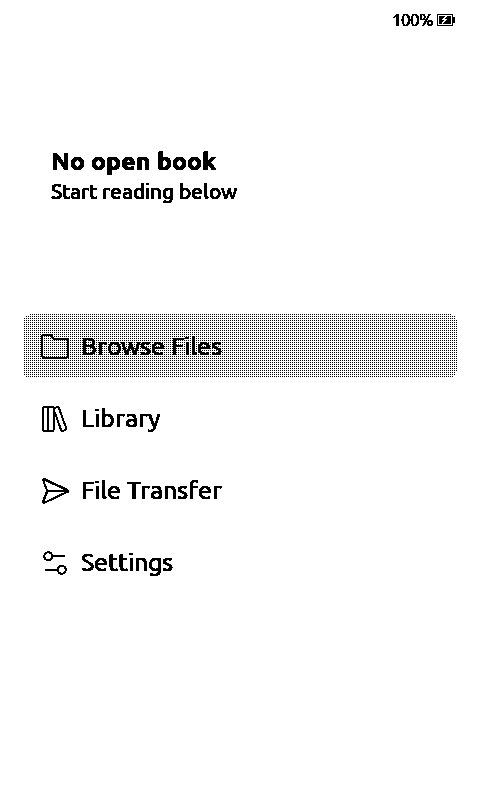

*Simulator picture of the Home screen. The real screen is e-ink.*

5. [ ] In the serial log, find the line that starts `[EPD] Picco panel` and write the panel's name: ____________ (YRD0426, DEPG0397, OPM040B3 or SE0400NQW47; unknown until this session)
6. [ ] Tap **Settings**. The version is at the top right. It must be `<version>-picco2`, with the kit's version. Write it: ____________

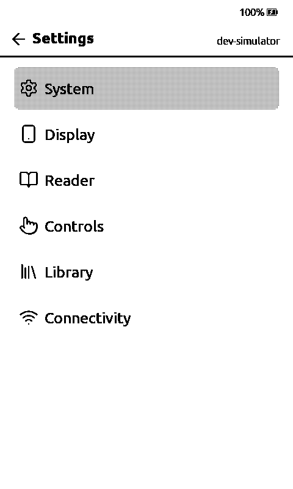

*Simulator picture. On the Picco the top right shows the kit's version instead of "dev-simulator". The real screen is e-ink.*

7. [ ] Open **System**. The serial log now shows a line that starts `[UPD] self-update allowed:`. Write the part after `running`: ____________ (expected: `0x20000`, the first app slot). Go back to Home.

If the Home screen does not appear: [Recovery: the Picco does not start](#the-picco-does-not-start-after-done). If it appears but touch or keys do not work: [Recovery: touch or keys are wrong](#touch-or-keys-are-wrong).

### Copy the books to the SD card

The firmware needs the books from the kit's `sd-card` folder on the Picco's SD card. Two ways exist. Use **File Transfer** if you are not sure the card can be taken out of the Picco (the team does not know this).

**Way 1: File Transfer by Wi-Fi (Create Hotspot).** This way the Picco makes its own Wi-Fi network, so you do not type your home Wi-Fi password into it and your network's name does not appear in the serial log.

8. [ ] On the Picco: Home > **File Transfer** > **Create Hotspot**.

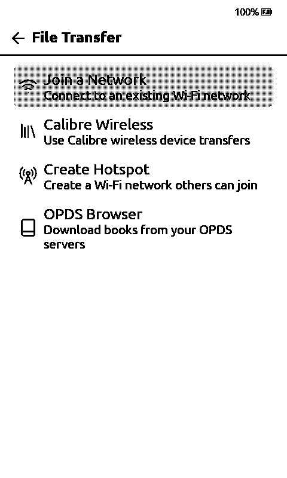

*Simulator picture of the File Transfer screen. The real screen is e-ink.*

9. [ ] On the PC, join the open Wi-Fi network `CrossPoint-Reader`. (The PC has no internet while it is joined.)
10. [ ] In Chrome, open the address the Picco shows: `http://crosspoint.local/`, or the number address shown below it (usually `http://192.168.4.1/`).
11. [ ] Open the **File Manager** page.
12. [ ] Create a folder named `books`, if there is none. Open it.
13. [ ] Upload the four `.epub` files from the kit's `sd-card\books` folder.
14. [ ] Go back to the top folder of the card. Upload `update.bin` from the kit's `sd-card` folder (needed only for step 8, harmless otherwise).
15. [ ] On the Picco, leave File Transfer (Back). On the PC, join your usual network again.

**Way 2: card reader.** Only if the Picco's SD card can be taken out. Switch the Picco off first, put the card into a card reader on the PC, copy the kit's `sd-card\books` folder to the card's top folder as `books`, and copy `sd-card\update.bin` to the card's top folder. Put the card back and switch the Picco on.

16. [ ] On the Picco: Home > **Browse Files** > `books`. You see the four books.

---

## Step 7. Controls check

Changes settings only. About 10 minutes.

The Device test menu has every screen for steps 7, 9, 10 and 11. On these screens: a short press of a side key moves the highlight (Up: up, Down: down); a hold of either side key for about 0.7 seconds chooses the highlighted row; a tap chooses the row under your finger. The bottom line says "Up/Down: move · hold: select".

1. [ ] Open Settings > **Display** > **Device test** (the first row).

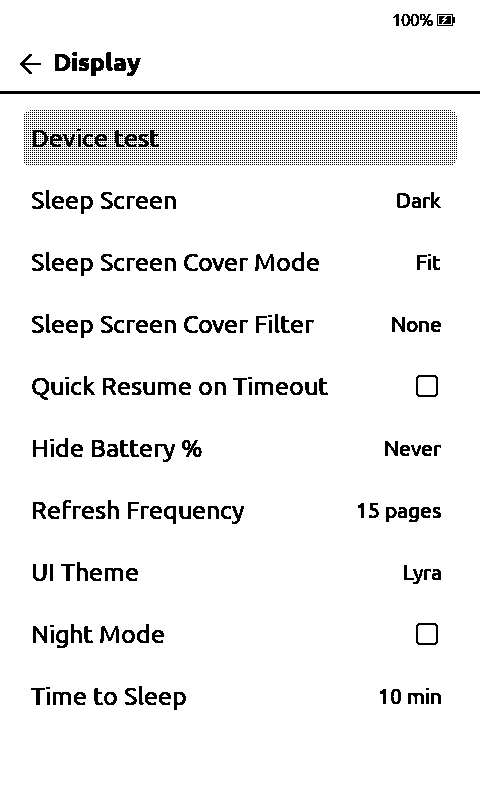 Display" width="240">

*Simulator picture of Settings > Display. The real screen is e-ink.*

2. [ ] The Device test menu opens. Its second line shows the panel, for example "Panel: DEPG0397 (SSD1677)". Check it is the panel you wrote in step 6.

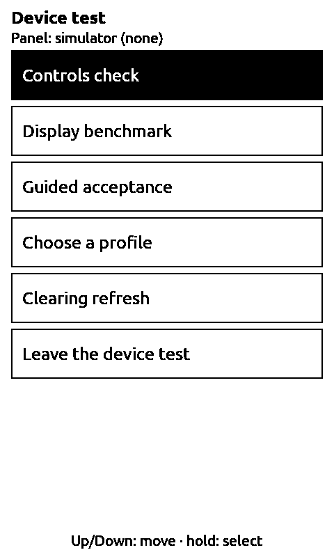

*Simulator picture of the Device test menu. On the Picco the second line names the real panel. The real screen is e-ink.*

3. [ ] Choose **Controls check**.
4. [ ] Press each side key once (short).
5. [ ] Hold each side key for about a second.
6. [ ] Press the power button once, **short** (a longer press puts the Picco to sleep).
7. [ ] Press any other key the Picco has once (for example a key on the front, if there is one). Write where it is: ____________
8. [ ] Tap the screen. Swipe left. Swipe right from the left edge.
9. [ ] Read the line "Not yet:". Try what it lists again. Every input appears as a numbered line, for example "2. key BTN_DOWN (5) -> Down PageForward NavNext, next, 906 ms, hold".

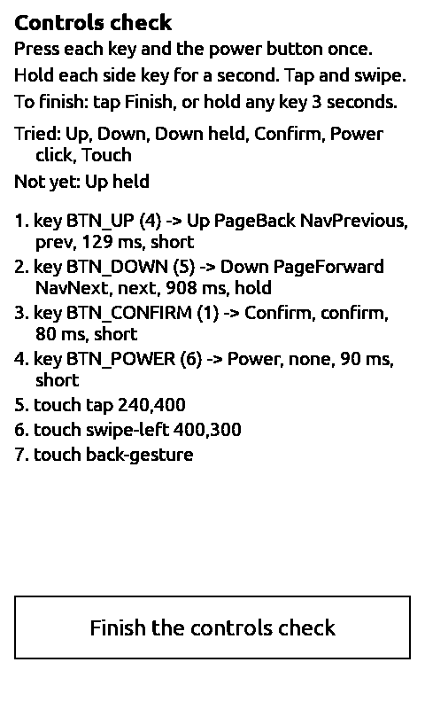

*Simulator picture of the Controls check after some inputs. On the Picco the hold times are your own. The real screen is e-ink.*

10. [ ] Write what you found:

* The key that showed `BTN_UP` is the ____________ key (where on the Picco: top or bottom, which side).
* The key that showed `BTN_DOWN` is the ____________ key.
* Did any key show `BTN_CONFIRM`? [ ] yes, it is the ____________ key   [ ] no key did
* Did the short power press show `BTN_POWER`, without sleeping? [ ] yes [ ] no
* Was the 0.7 second hold comfortable? [ ] yes [ ] no, notes: ____________
* Did anything appear that you did not press? [ ] no [ ] yes: ____________

11. [ ] Leave: tap **Finish the controls check**, or hold any side key for 3 seconds.

### If the side keys feel reversed

In this firmware Up means "previous" and Down means "next". If that feels the wrong way round on the Picco:

12. [ ] Leave the Device test (row "Leave the device test").
13. [ ] Settings > **Controls** > **Side buttons** > **Layout (reader only)**: set it to **Next/Prev**. This one setting turns the keys round in page view and on the speed-reading and checkpoint screens.

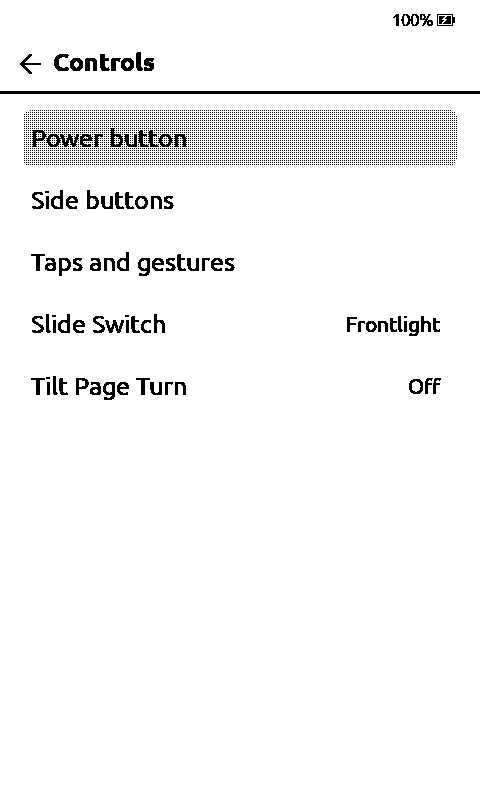 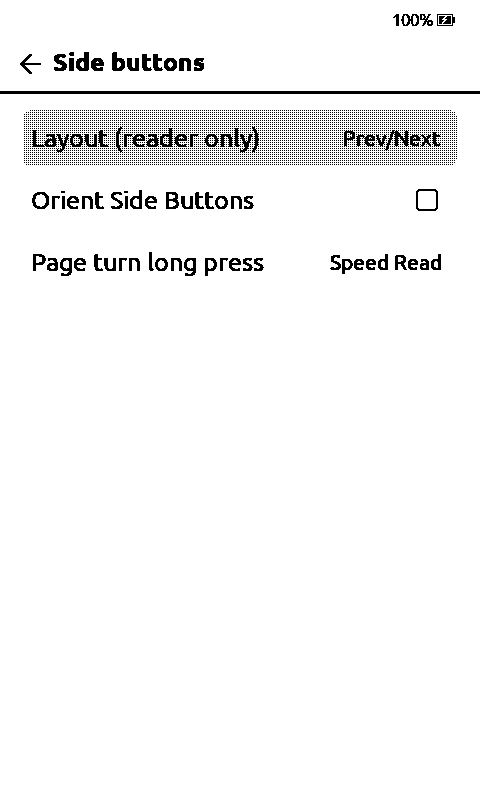

*Simulator pictures of Settings > Controls and its Side buttons page. The real screen is e-ink.*

### If no key showed `BTN_CONFIRM`

The Picco may have no Confirm key. All new screens work without it. Upstream's lists (Settings, the reader menu) then need touch. If you want a key for Confirm:

14. [ ] Settings > **Controls** > **Power button** > **Short click**: set it to **Confirm**. A short power press is then Confirm everywhere. A long press still puts the Picco to sleep.

*Simulator picture of Settings > Controls > Power button. The real screen is e-ink.*

15. [ ] Write every setting you changed: ____________

---

## Step 8. Prove the update path (optional)

Writes the same firmware into the second app slot. About 10 minutes. Skip it if you are short of time. Keep the cable and the serial log running.

1. [ ] Check that `update.bin` is in the top folder of the SD card (step 6, line 14).
2. [ ] Settings > **System** > **SD Card Firmware Update**. (This row appears only on the new two-slot layout, so the simulator picture below does not show it.)

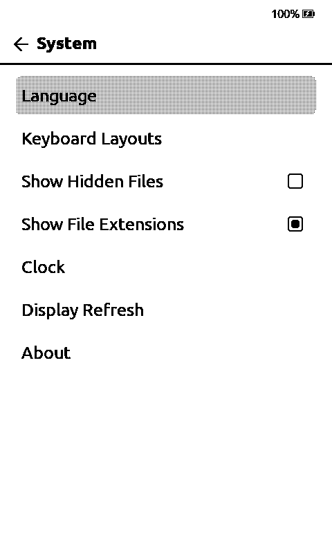

*Simulator picture of Settings > System. On the Picco, "Check for Updates" and "SD Card Firmware Update" appear between "Clock" and "Display Refresh". The real screen is e-ink.*

3. [ ] The Picco shows "Select firmware file (.bin)". Choose `update.bin`.
4. [ ] It shows "Validating firmware..." and then the question "Update firmware?" with the file name `update.bin`. Choose to go on (confirm).
5. [ ] It shows "Do not power off!" while it writes, then "Update complete". Wait. The Picco restarts by itself.
6. [ ] The Home screen appears again.
7. [ ] Open Settings > **System**. In the serial log, the new `[UPD] self-update allowed:` line must now say `running 0x800000` (the second app slot). Write it: ____________

**It worked if** the Picco restarted into the Home screen and the log says `running 0x800000`. The version stays the same: it is the same firmware.

**If it goes differently:** "Update failed", "Invalid firmware file", "Firmware is for a different device" or "Firmware write failed" means the Picco still runs the firmware it had (the update writes the other slot and switches only at the end). Write the message here, and carry on with step 9: ____________

**The Wi-Fi update** (Settings > System > Check for Updates) is not part of this session. It installs only a **published** normal release with a higher version than the running one. No such release exists during the first session, so it would say there is no update.

---

## Step 9. Display benchmark

Changes settings only (it unlocks the trial profiles it runs; the profile used for reading stays Stock). About 50 to 60 minutes. Keep the serial log running: the same figures go to the log, so nothing is lost if the SD card cannot be written.

### What the times are

The benchmark runs ten steps for each display profile: Stock first, then each trial the panel allows. Estimates from predicted timings:

| Panel | Profiles | Time |
| --- | --- | --- |
| DEPG0397 | Stock, Trial A, B, C, D | about 50 minutes (Stock about 12, Trial A 10, Trial B 9.5, Trials C and D 9 each) |
| YRD0426 or OPM040B3 | Stock, Trial A, B, C, D | not predicted; at the Xteink X4's figures about 14 minutes a profile, about an hour in all |
| SE0400NQW47 | Stock and Trial D only | about 25 minutes |
| not recognised | Stock only | about 14 minutes |

The overview screen shows the Picco's own estimate. Each profile asks you seven times how readable the text was; allow about 15 seconds for each answer.

### What the ratings mean

* **Clean:** you read every word without effort, and no grey remains of earlier words are visible.
* **Tolerable:** you could read the words, but with some effort, or faint remains are visible but do not hide any letter.
* **Unreadable:** you missed words or could not read them, or remains made letters hard to tell apart.

Look at the last frame before you answer: it stays on the screen, unchanged, until you press a key or touch.

### Run it

1. [ ] Device test menu > **Display benchmark**.
2. [ ] **Room temperature.** It starts as "unknown". Choose **Warmer: +1 °C** or **Cooler: -1 °C** until it shows the room's temperature (the first press gives 20 °C). If you have no thermometer, choose **Temperature unknown**. Then **Continue**.

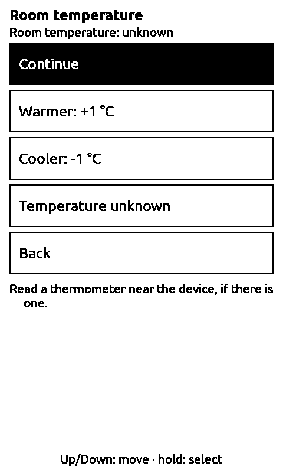

*Simulator picture of the Room temperature screen. The real screen is e-ink.*

3. [ ] **Overview.** It shows the panel, the battery, the profiles that will run ("To run: Stock, ..."), any that will not run and why, and "Each profile takes about n minutes". Write the profiles to run: ____________ and the estimate: ______ minutes per profile.

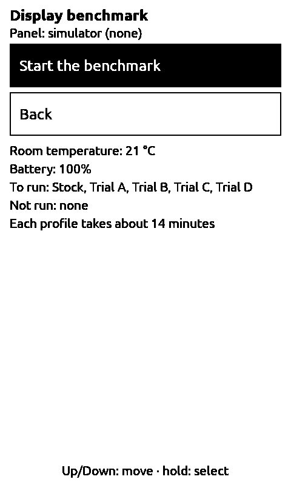

*Simulator picture of the Overview. On the Picco it names the real panel and battery level. The real screen is e-ink.*

4. [ ] Choose **Start the benchmark**.
5. [ ] Each step shows "<profile> · step k / 10" and what it does. Do not touch the Picco while it runs: **a key or a touch stops the step.**

*Simulator picture of a step running. The real screen is e-ink.*

6. [ ] When the words stop, look at the screen. Then press a key or touch it.
7. [ ] **"How readable was it?"** Choose **Clean**, **Tolerable** or **Unreadable**. Choose **Repeat step** if you did not watch it. Below the rows it shows the delivered WPM, the words drawn and the order check.

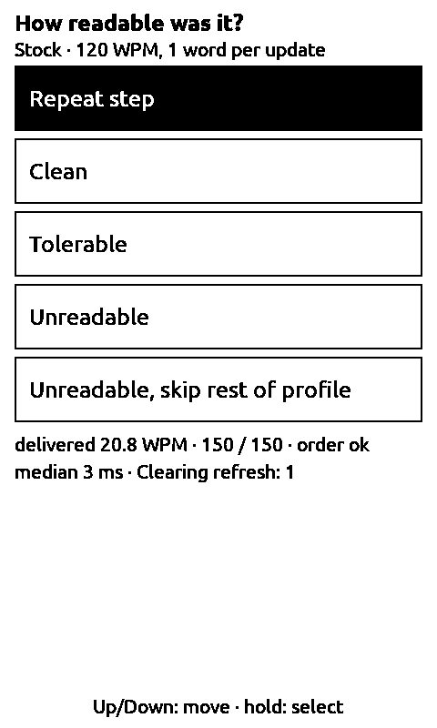

*Simulator picture of the rating question. The real screen is e-ink.*

8. [ ] After the last step of a profile (the endurance run, 300 updates), it also asks **"Was residue visible after the run?"**: **No residue** or **Residue visible**.
9. [ ] The **profile summary** shows the figures of that profile. Choose **Next profile: <name>**, or **Finish the benchmark** after the last one.

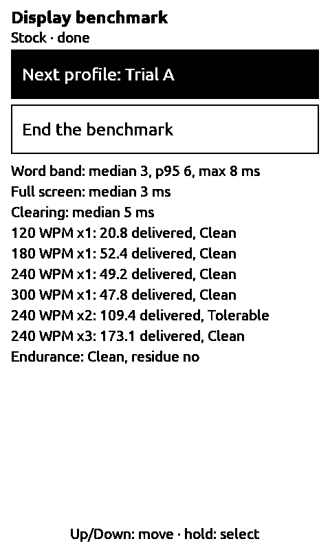

*Simulator picture of a profile summary. On the Picco the times are the panel's real times. The real screen is e-ink.*

10. [ ] At the end you see "Benchmark finished" and "Saved as /rsvp-bench/NNNN-bench.json". Write the file name: ____________
11. [ ] Choose **Back to the device test menu**.

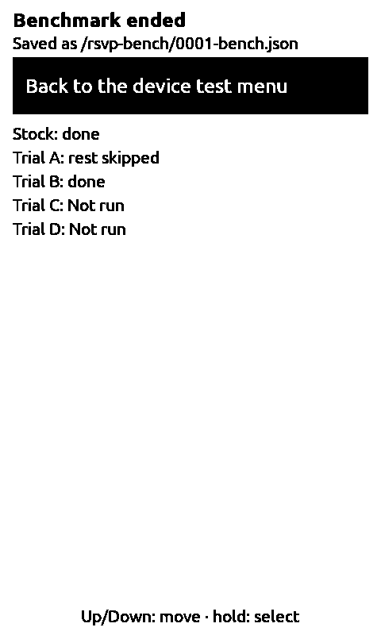

*Simulator picture of the end of the benchmark. The real screen is e-ink.*

If you stopped a step by accident, the **"Step stopped"** screen offers **Repeat step**, **Skip the rest of this profile** and **End the benchmark**. Choose **Repeat step**.

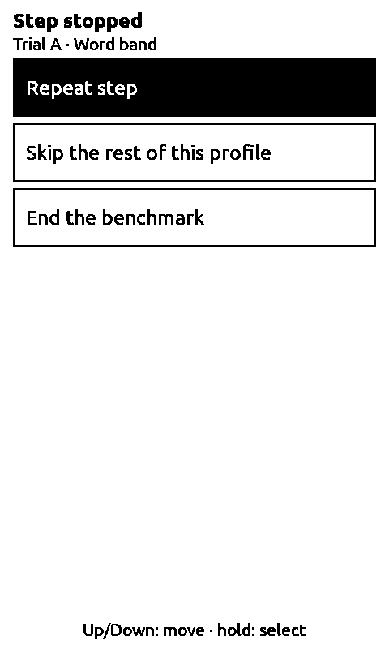

*Simulator picture of the "Step stopped" screen. The real screen is e-ink.*

### Heavy residue

If a trial profile leaves heavy residue (grey remains that make text hard to read):

1. [ ] Rate the step **Unreadable, skip rest of profile**. The next screen is drawn with a clearing refresh, which removes residue.
2. [ ] On the profile summary, choose **Next profile: <name>** to carry on with the next profile.
3. [ ] If remains are still visible later, choose **Clearing refresh** in the Device test menu. It runs one more clearing refresh.

**If it goes differently:** "Could not save the results file: see the serial log" means the figures are only in the serial log. Keep the log; carry on. If the Picco sleeps or restarts during the benchmark, the file keeps what was measured so far; start the benchmark again from the menu (it makes a new file).

---

## Step 10. Guided acceptance

Changes nothing on the Picco but the walk-through's own files. About 50 minutes, an hour at most.

The Picco shows the instructions for every step on its screen. They are also printed below, so that you can read ahead. **If the screen and this sheet differ, follow the screen** and note the difference.

### Part A: two playback runs (about 4 minutes)

1. [ ] Device test menu > **Guided acceptance**.
2. [ ] The start screen says "Display profile: <name>" (Stock until step 11). Choose **Start part A**.

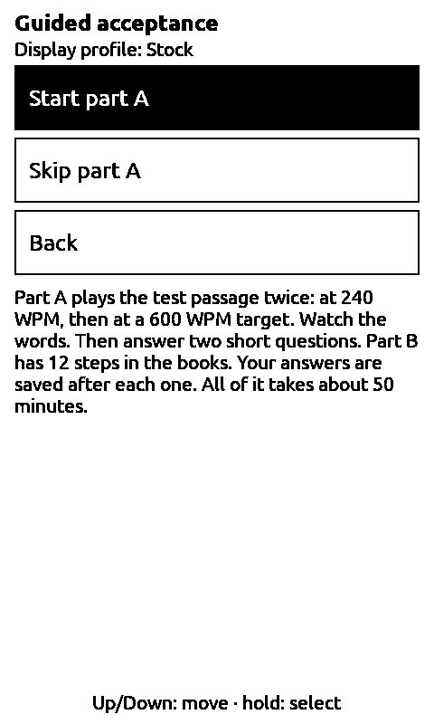

*Simulator picture of the Guided acceptance start screen. The real screen is e-ink.*

3. [ ] Run 1 plays the test passage at 240 WPM. Watch the words. Do not touch the Picco: a key or a touch stops the run. When the words stop, look, then press a key or touch.
4. [ ] **"Was the last sentence readable?"** Choose **Yes, it was readable** or **No**. Below the rows: the target and delivered WPM, and "Words: 150 / 150, each once, in order" (or "ORDER CHECK FAILED").

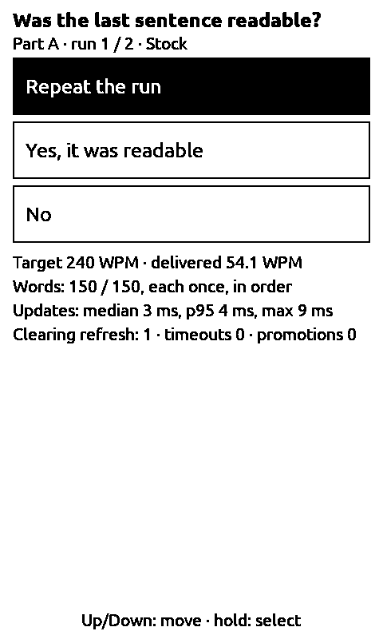

*Simulator picture of the "readable" question. On the Picco the numbers are measured. The real screen is e-ink.*

5. [ ] Run 2 plays the passage at a 600 WPM target. The panel is slower than that, so the words should come more slowly, one after another, with no word missing. Watch, then press a key or touch.
6. [ ] Answer **"Was the last sentence readable?"** again.
7. [ ] **"Was it slower than 600 WPM?"** Choose **Yes: slower, no word missing** or **No**. Write the delivered WPM shown: ______ WPM

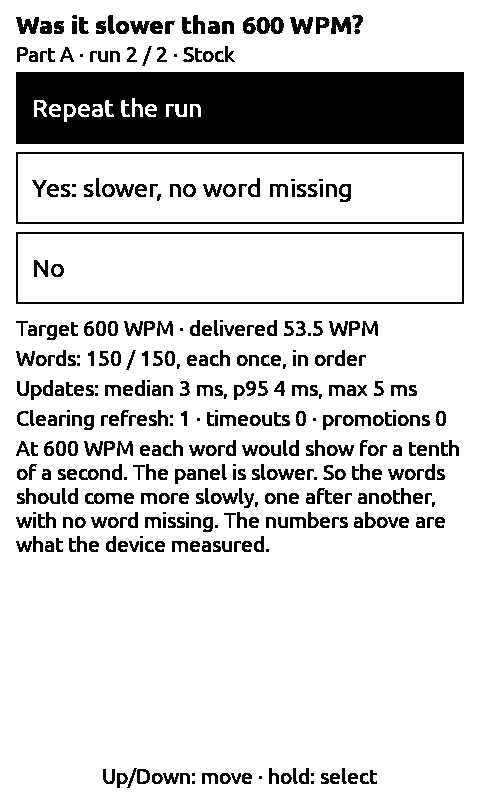

*Simulator picture of the "slower" question. On the Picco the numbers are measured. The real screen is e-ink.*

8. [ ] **"Part A done"** shows one line per run and "Automatic check: Pass · your answers: Pass" (or Fail). Write it: ____________. Choose **Continue to part B**.

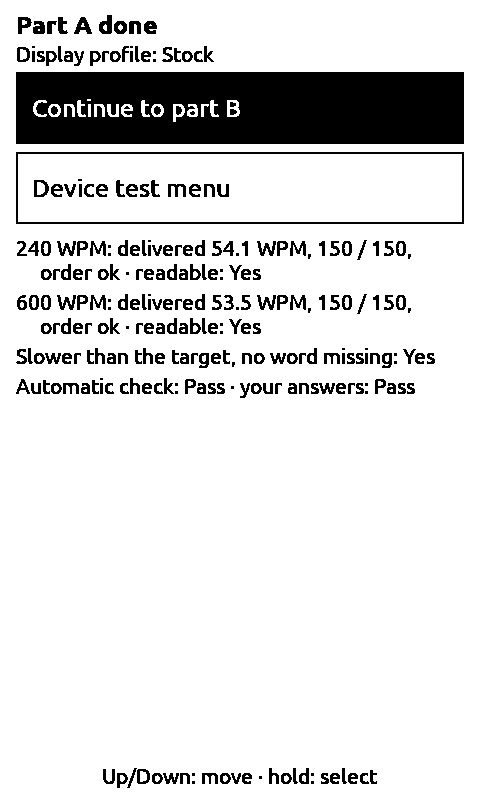

*Simulator picture of "Part A done". The real screen is e-ink.*

If you stop a run by accident, "Run stopped" offers **Repeat the run** and **Skip part A**. Choose **Repeat the run**.

### Part B: twelve steps in the books (about 45 minutes)

Each step has two screens.

1. [ ] **The instructions:** "Step k of 12", the step's title, what to do, and "Expected:" with what should happen. Read them. Choose **Leave to do this step**. The Device test closes.

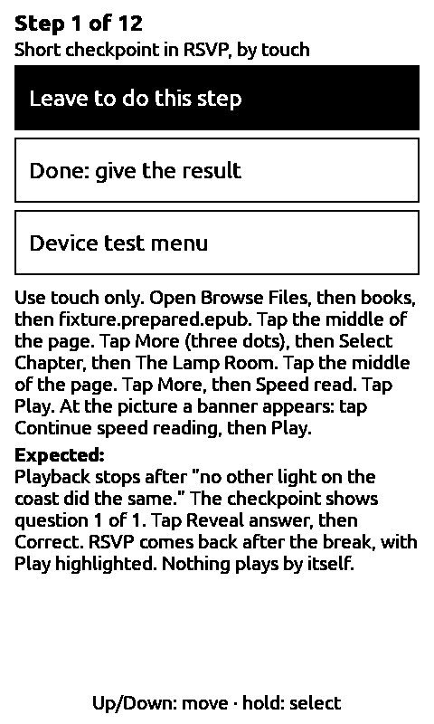

*Simulator picture of a step's instructions. The real screen is e-ink.*

2. [ ] Go Home (swipe up from the bottom edge) and do the step in the book.
3. [ ] Come back: Settings > Display > Device test > **Guided acceptance**. The question opens at once.
4. [ ] **"Step k: how did it go?"** Choose **Pass** if what happened matched "Expected:". Choose **Fail** if it did not. Choose **Skip this step** if you cannot do it. **Not done yet** goes back to the instructions and records nothing.

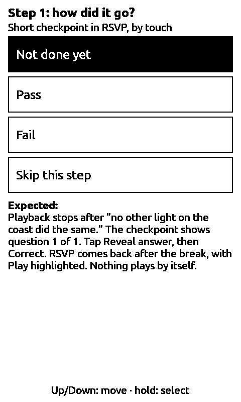

*Simulator picture of a step's question. The real screen is e-ink.*

5. [ ] After **Fail**, **"What went wrong?"** asks for a reason: **It did not appear**, **It appeared at the wrong place**, **Wrong mode after it**, **A grade was lost or wrong** or **Something else**. Write what you saw in the [results sheet](#appendix-e-results-sheet).

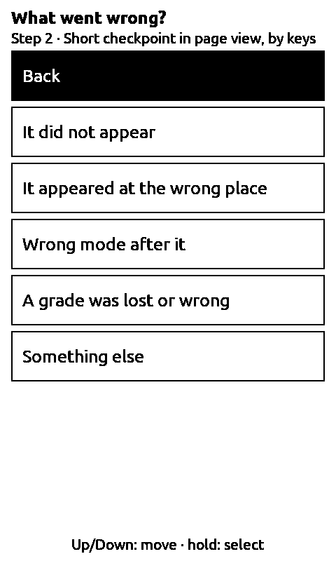

*Simulator picture of the fail reasons. The real screen is e-ink.*

6. [ ] Repeat for all twelve steps. Your answers are saved after each one. You can take a break between two steps: the menu row then says, for example, "Guided acceptance: step 4 of 12".
7. [ ] At the end, **"Guided acceptance done"** shows "Saved as /rsvp-bench/NNNN-acceptance.json", one line per criterion, and "Criterion 6 (preparing books) is not checked on the device." Write the file name: ____________. Choose **Back to the device test menu**.

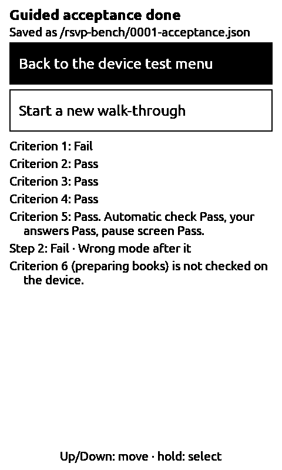

*Simulator picture of the summary. The real screen is e-ink.*

The twelve steps use the books `fixture.prepared.epub` (steps 1 to 10) and `fixture.epub` (steps 11 and 12) in the `books` folder. The full text of each step is in [Appendix A](#appendix-a-the-twelve-steps-of-part-b). Pictures of the reading screens you will meet are in [Appendix B](#appendix-b-screens-you-meet-in-part-b).

---

## Step 11. Choose a profile

Changes settings only. About 5 minutes.

1. [ ] Device test menu > **Choose a profile**. It shows "Now: <profile>", one row per profile you may choose (Stock, and each trial the benchmark unlocked that this panel allows), and below them the ratings from the benchmark file, for example "Trial B · 6 clean · 188 WPM".

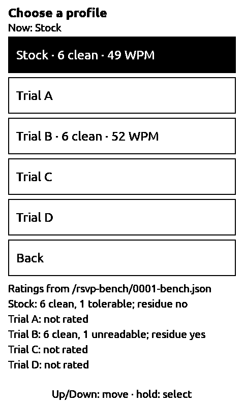

*Simulator picture. On the Picco the ratings and WPM are yours. The real screen is e-ink.*

2. [ ] Choose the profile to keep for reading. A suggestion: the fastest trial (the highest WPM on its row) that you rated **Clean** in every step, or in all but one, and with no residue. If no trial is like that, choose **Stock**.
3. [ ] **"Keep other trials?"** lists the other trials, each as "lock again". Keep another trial only if you rated it clean too: choose its row to change it to "keep". To return to the factory state, choose Stock and keep nothing.

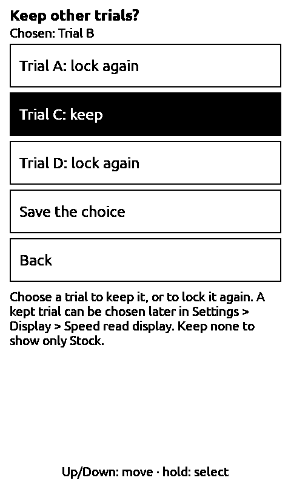

*Simulator picture. The real screen is e-ink.*

4. [ ] Choose **Save the choice**.
5. [ ] **"Profile saved"** shows "Saved as /rsvp-bench/NNNN-choice.json", "Speed reading uses: <profile>", what is kept and what is locked again. Write the profile: ____________ and the file name: ____________

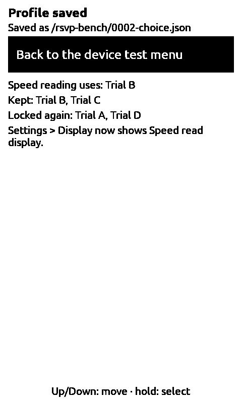

*Simulator picture. The real screen is e-ink.*

6. [ ] If you kept a trial, Settings > Display now has a second row, **Speed read display**, where you can change the profile later.

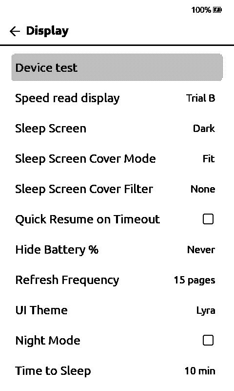

*Simulator picture of Settings > Display with the new row. The real screen is e-ink.*

7. [ ] Choose **Back to the device test menu**, then **Leave the device test**.

---

## Step 12. Return evidence

About 20 minutes.

**Never post the backup or any `.bin` file.** The repository is public. The backup holds the Picco's settings area, which may include your Wi-Fi details, and Onyx's firmware. Never attach the `work` folder, a ZIP of it, or any file from `work\logs`.

### Stop the serial log and make the summary

1. [ ] In the PowerShell window with the serial log, press **Ctrl+C**. You see <!--q-->`Serial log saved:` and the file's name.
2. [ ] Type:

Command: <!--cmd-->`powershell -ExecutionPolicy Bypass -File .\session.ps1 summary`

3. [ ] You see <!--q-->`Summary written:` and the file name `work\session-summary-<time>.txt`. Every line of this file is safe to share. It lists what identify and backup found, each of the four flash images with whether it was written and verified (or where the flash stopped), whether each restore was verified, fingerprints instead of files, every command you ran with its result, and the last lines the tool showed. Your MAC address is partly hidden and your Windows user name is removed.

### Collect the files to send

4. [ ] The results files from the Picco's SD card: **every file in the folder `/rsvp-bench/`** (names like `0001-controls.json`, `0002-bench.json`, `0003-acceptance.json`, `0004-choice.json`). Get them with File Transfer (step 6, lines 8 to 11: open the `rsvp-bench` folder in the File Manager and download each file) or with a card reader. Ignore files ending in `.tmp`.
5. [ ] The serial logs: the files `work\serial-<time>.log` in the kit folder (one for each time you started `monitor`).
6. [ ] Open each serial log in Notepad. Press Ctrl+F and search for your home Wi-Fi network's name. If you find it, replace it with `WIFI` and save. (With Create Hotspot it should not be there.)
7. [ ] The summary file `work\session-summary-<time>.txt` (the newest one). It already holds the flash result for each image, so you do not need to copy anything from the PowerShell window.

### Open the results issue

8. [ ] Open <https://github.com/c-tphr/eink-learner-aid/issues/new?template=device-session-results.md>. The title is "Device session results".
9. [ ] Fill in each field from your [results sheet](#appendix-e-results-sheet).
10. [ ] Attach the `/rsvp-bench/` files, the serial logs and the summary file. GitHub does not accept `.json` and `.log` files everywhere: if it refuses one, put the files into one ZIP and attach that ZIP (it must not contain any `.bin` file).
11. [ ] Submit.

---

## Recovery

Find your case below. In every case: **do not try button combinations or special start-up modes.** None are known to be safe for the Picco. Do not unplug the Picco while the tool writes.

To restore, the tool needs the backup `.bin` file and its `.json` record **in the same folder**. The command in this section uses the file in `work`. If that file is lost, use the copy on the USB stick, with the stick's path instead (for example `"E:\picco-backup-<...>.bin"`).

### Flashing stops part-way

The flash stopped before `DONE`. The tool then shows <!--q-->`FLASHING DID NOT COMPLETE. The Picco may not start until it is restored.` and <!--q-->`Do not unplug it and do not close this window yet.` Under <!--q-->`To put the Picco back exactly as it was, run:` it shows the restore command, with your backup's full path in quotes.

1. [ ] Do not unplug the Picco. If the cable came out, plug it back in, straight into the PC.
2. [ ] **Type the command the tool shows** under that line, exactly as shown, in the same window. It looks like this, with your kit folder and your backup's name:

Command: <!--cmd-->`powershell -ExecutionPolicy Bypass -File .\session.ps1 restore "C:\picco\picco-2slot-<version>\work\picco-backup-<...>.bin"`

   If the window was closed, open PowerShell in the kit folder again and type the same command with the backup's name. The part in `work` is enough there:

Command: <!--cmd-->`powershell -ExecutionPolicy Bypass -File .\session.ps1 restore "work\picco-backup-<...>.bin"`

3. [ ] The tool shows the backup, checks its fingerprint and says <!--q-->`Guard: one image of exactly 16,777,216 bytes at 0x0. APPROVED.`
4. [ ] It asks <!--q-->`To overwrite the whole Picco flash with this backup, type exactly:  RESTORE BACKUP` Type, in capital letters, and press Enter:

   Phrase: <!--type-->`RESTORE BACKUP`

5. [ ] It writes 16 MB and reads all of it back. This takes several minutes. Do not unplug.
6. [ ] **It worked if** you see <!--q-->`VERIFIED: the whole flash now equals the backup` and <!--q-->`The Picco has been reset and should start as before.` The Picco runs Onyx's firmware again, exactly as at the backup.
7. [ ] Stop the session. Send the summary and a description of what happened (step 12). Do not flash again before the team has looked at it.

Why this works: the chip's first-stage loader is in read-only memory (ROM), and no flash content can break it. The restore needs only that loader. The tool writes the four images so that every half-written state either still starts Onyx, starts the new firmware, or starts nothing; none of them runs Onyx's code under the new bootloader. This was worked out from Espressif's documentation; it has not been tried on a Picco.

If the restore also fails:

| You see | What to do |
| --- | --- |
| <!--q-->`RESTORE DID NOT COMPLETE:` with <!--q-->`Your backup file is unchanged. Do not unplug the Picco.` | Type the command the tool shows below <!--q-->`Run the restore again; if it fails again, try another USB cable or port:` (the same restore command). If it fails again, try another USB cable, or another USB port on the PC, and type it again. |
| <!--q-->`COULD NOT REACH THE PICCO'S CHIP. Nothing was read or written.` | See [the Picco is not found](#the-picco-is-not-found-or-the-wrong-com-port), then run the restore again. |
| <!--q-->`WARNING: this backup was taken from MAC` | The connected chip is not the one in the backup. Stop. Check you connected the right Picco. Type <!--type-->`RESTORE TO A DIFFERENT DEVICE` only if the team tells you to. |
| <!--q-->`REFUSED. Nothing was written.` | Read the reasons. Usually the `.json` record is not beside the `.bin`, or the file is not the verified backup. Use the copy from the USB stick. |

If the restore keeps failing, stop. Leave the Picco connected and switched on if you can. Report what the window shows. Do not try anything else.

### The Picco does not start after DONE

The flash said `DONE`, but the screen stays blank or still shows Onyx's last picture (e-ink keeps the last picture even when nothing runs).

1. [ ] Wait one minute.
2. [ ] Look at the serial log window (step 6). Lines from the Picco mean it runs: wait a little more.
3. [ ] If nothing appears: hold the power button for about half a second, then wait one minute.
4. [ ] If still nothing appears: press Ctrl+C in the log window, then start the log again with `-Reset` (step 6, line 1). Wait one minute.
5. [ ] If the screen still does not change and the log shows nothing from the firmware: press Ctrl+C in the log window (the restore needs the port), then run the restore, as in [flashing stops part-way](#flashing-stops-part-way), lines 2 to 7.

The tool cannot test in advance whether the new firmware starts on this Picco; this is the reason the backup exists.

### Touch or keys are wrong

The Home screen appears, but touch or a key does not work, or does the wrong thing.

1. [ ] Continue with whichever input works. Every Device test screen works with the two side keys alone (short press: move; hold: choose) and with touch alone.
2. [ ] Do the [Controls check](#step-7-controls-check) and write down what each input does.
3. [ ] If the side keys are reversed: step 7, "If the side keys feel reversed".
4. [ ] If touch does not work and no key shows `BTN_CONFIRM`: upstream's lists (Settings) need touch or Confirm. If you cannot reach Settings > Display > Device test, stop and report it. The team fixes the input later with an SD-card update file.
5. [ ] Write in the results sheet which input failed and how.

### The Picco is not found, or the wrong COM port

The tool says <!--q-->`COULD NOT REACH THE PICCO'S CHIP. Nothing was read or written.` or <!--q-->`No Espressif USB serial port was found.` Nothing was written in either case.

1. [ ] Use a cable that carries data. Try the second cable.
2. [ ] Plug it straight into the PC.
3. [ ] Make sure the Picco is switched on. Before the flash: on its Home screen, not in USB drive mode.
4. [ ] Close any other program that might use the port (serial terminal, Arduino IDE, another `session.ps1` window, including one running `monitor`).
5. [ ] List the serial ports the tool sees:

Command: <!--cmd-->`powershell -ExecutionPolicy Bypass -File .\session.ps1 ports`

   It prints <!--q-->`Serial ports:` and one line per port. The Picco's line ends with `<- Espressif USB-Serial/JTAG`. Its name is `COM` and a number.
6. [ ] Open Device Manager (right-click Start > **Device Manager**) > **Ports (COM & LPT)**. Unplug and plug in the Picco and watch which entry appears, for example "USB Serial Device (COM5)".
7. [ ] Run the command again with that port, for example `-Port COM5` at the end of the line. The COM number can change after the Picco restarts: check again if a command that worked before cannot find it.

If nothing appears with two cables, stop and report it.

### The PC slept, or the cable came out

| When | What to do |
| --- | --- |
| During identify or backup | Nothing was written. Plug the cable back in and run the command again. |
| During the flash | If the window does not show <!--q-->`DONE: all four images written and verified.` treat it as [flashing stops part-way](#flashing-stops-part-way): run the restore. |
| During a restore | Run the restore again, as in [flashing stops part-way](#flashing-stops-part-way), line 2. |
| During the serial log (`monitor`) | The log waits for the port and continues. If the window closed or shows an error, start `monitor` again (step 6, line 1, without `-Reset`). Each start makes a new log file; send them all. |
| During the benchmark or the walk-through | The Picco does not need the PC for these. Only the serial log stops: start it again. |

### The firmware starts but a menu does not work

Later firmware fixes come as an SD-card update file. If the firmware starts but its menus cannot reach **SD Card Firmware Update**, the new layout has a recovery picker: hold the key that showed `BTN_UP` in step 7 while you wake the Picco with the power button. This has not been tried on a Picco. Use it only when the team asks.

---

## After the session

* **Keep using the Picco.** It runs the new firmware. Speed read works in any EPUB; checkpoints appear only in prepared books.
* **A later fix** arrives as an SD-card update file, `update.bin` in a new kit, or `eink-learner-aid-v<version>-picco2.bin` on a release. Copy it to the SD card's top folder and choose Settings > System > **SD Card Firmware Update**, as in step 8. No PC and no cable are needed.
* **Wi-Fi updates** (Settings > System > **Check for Updates**) offer a release only when the team has published a normal release with a higher version.
* **To return to Onyx's firmware**, connect the Picco, open PowerShell in the kit folder and run the restore of [Recovery](#flashing-stops-part-way), lines 2 to 6. You need the kit folder and both backup files.
* **Keep the backup** (`.bin` and `.json`) on the USB stick for as long as you have the Picco. It is the only way back to Onyx's firmware. Never upload it.
* Set the PC's sleep setting back.

---

## Appendix A: the twelve steps of Part B

This is the text the Picco shows for each step ("Instructions" and "Expected"). Navigation is described by touch: the middle of a page opens the toolbar; its More button (three dots) opens the list with Speed read and Select Chapter. The book for steps 1 to 10 is `fixture.prepared.epub`, *The Lighthouse Keeper's Almanac*. Its first checkpoint (one question) follows "no other light on the coast did the same." in chapter 1, The Lamp Room. Its second checkpoint (three questions) ends chapter 2, The Fog Season, after "to put out the lamp."

**Step 1 of 12: Short checkpoint in RSVP, by touch** <!--step:c0001-rsvp-touch-->

Instructions: Use touch only. Open Browse Files, then books, then fixture.prepared.epub. Tap the middle of the page. Tap More (three dots), then Select Chapter, then The Lamp Room. Tap the middle of the page. Tap More, then Speed read. Tap Play. At the picture a banner appears: tap Continue speed reading, then Play.

Expected: Playback stops after "no other light on the coast did the same." The checkpoint shows question 1 of 1. Tap Reveal answer, then Correct. RSVP comes back after the break, with Play highlighted. Nothing plays by itself.

Result: [ ] Pass [ ] Fail [ ] Skip · notes: ____________

**Step 2 of 12: Short checkpoint in page view, by keys** <!--step:c0001-page-keys-->

Instructions: Tap Page view. Tap the middle of the page, More, Select Chapter, The Lamp Room. From here use the side keys only. Press the next-page key to turn pages. Stop on the page that shows "did the same." Press the next-page key once more.

Expected: The checkpoint shows question 1 of 1 and "Recorded earlier: Correct". Press Down twice, then hold Down: Skip checkpoint. Page view shows the page after the break. Nothing else happens.

Result: [ ] Pass [ ] Fail [ ] Skip · notes: ____________

**Step 3 of 12: A jump does not fire a checkpoint** <!--step:toc-jump-->

Instructions: Use touch. Open Select Chapter and choose The Fog Season. Open Select Chapter again and choose The Keeper's Log. Open Select Chapter again and choose The Lamp Room.

Expected: No checkpoint appears after any of the three jumps.

Result: [ ] Pass [ ] Fail [ ] Skip · notes: ____________

**Step 4 of 12: Long checkpoint in RSVP, by keys** <!--step:c0002-rsvp-keys-->

Instructions: Open Select Chapter and choose The Fog Season. Turn pages to the last page of the chapter. It ends with "to put out the lamp." From here use the side keys only. Hold Down: Speed read opens. Hold Down: Play.

Expected: Playback stops after "to put out the lamp." The checkpoint shows question 1 of 3. Hold Down: Reveal answer. Press Down, then hold: Correct. Question 2 of 3 shows. Hold Down: Reveal answer. Press Down twice, then hold: Incorrect. The screen says "marked Incorrect". Reread in RSVP is highlighted.

Result: [ ] Pass [ ] Fail [ ] Skip · notes: ____________

**Step 5 of 12: Reread in RSVP to the end** <!--step:reread-rsvp-end-->

Instructions: Hold Down: Reread in RSVP. Hold Down: Play. Let it play to the end of the section. You may raise the WPM first to make it shorter.

Expected: The reread starts at "The Visitor from the Mainland". The pause screen has a row "Back to the question". After "to put out the lamp." question 2 of 3 shows again, with the answer hidden. Reveal it, then mark Incorrect again.

Result: [ ] Pass [ ] Fail [ ] Skip · notes: ____________

**Step 6 of 12: Reread in page view, return early, retry** <!--step:reread-page-early-->

Instructions: Use touch. Tap Reread in page view. Turn one page. Tap "Back to the question" at the top.

Expected: Question 2 of 3 shows again, with the answer hidden. Tap Reveal answer, then Correct. Question 3 of 3 shows.

Result: [ ] Pass [ ] Fail [ ] Skip · notes: ____________

**Step 7 of 12: Skip a question, reading resumes** <!--step:skip-question-resume-->

Instructions: On question 3 of 3, tap Skip question.

Expected: The checkpoint ends. RSVP shows its pause screen at the start of The Keeper's Log. Play is highlighted. Nothing plays by itself.

Result: [ ] Pass [ ] Fail [ ] Skip · notes: ____________

**Step 8 of 12: Read it again: the first grades are kept** <!--step:later-pass-grades-->

Instructions: Use touch. Tap Page view. Open Select Chapter and choose The Fog Season. Turn to the last page of the chapter. Swipe to the next page.

Expected: Question 1 of 3 shows "Recorded earlier: Correct". Tap Skip question. Question 2 of 3 shows "Recorded earlier: Incorrect", not Correct. Tap Skip checkpoint. Page view shows the start of The Keeper's Log.

Result: [ ] Pass [ ] Fail [ ] Skip · notes: ____________

**Step 9 of 12: Close the book during a question** <!--step:close-in-question-->

Instructions: Open Select Chapter and choose The Lamp Room. Turn pages until question 1 of 1 shows. Swipe up from the bottom edge: Home. Open fixture.prepared.epub again.

Expected: The book opens at question 1 of 1, with the answer hidden. Tap Skip checkpoint. Page view shows the page after the break.

Result: [ ] Pass [ ] Fail [ ] Skip · notes: ____________

**Step 10 of 12: Sleep during a reread** <!--step:sleep-in-reread-->

Instructions: Open Select Chapter and choose The Lamp Room. Turn pages until question 1 of 1 shows. Tap Reveal answer, then Incorrect, then Reread in page view. Turn one page. Hold the power button until the device sleeps. Wake it. If the book is not open, open fixture.prepared.epub.

Expected: Page view is in the reread, on the same page, with "Back to the question" at the top. Tap it. Question 1 of 1 shows with the answer hidden. Tap Skip checkpoint. Page view shows the page after the break.

Result: [ ] Pass [ ] Fail [ ] Skip · notes: ____________

**Step 11 of 12: An ordinary book: pictures, tables, code** <!--step:ordinary-book-items-->

Instructions: Go Home. Open Browse Files, books, fixture.epub (the copy without checkpoints). Choose The Lamp Room. Open Speed read. Tap Play. At the picture tap Continue speed reading, then Play. Choose The Fog Season, open Speed read, Play. Choose The Keeper's Log, open Speed read, Play.

Expected: RSVP stops before the picture, the table and the code block. Each time a banner says "... Speed reading stopped here." with Continue speed reading and Stay in page view. No checkpoint appears in this book.

Result: [ ] Pass [ ] Fail [ ] Skip · notes: ____________

**Step 12 of 12: The pause screen shows the actual pace** <!--step:pause-screen-600-->

Instructions: Stay in fixture.epub. Open Speed read. Tap + next to the WPM until it shows 600. Tap Play. After about 20 seconds, touch the screen to pause.

Expected: The top line reads "Paused · 600 WPM target · N actual". N is below 600. The words came one at a time, slower than 600 WPM.

Result: [ ] Pass [ ] Fail [ ] Skip · notes: ____________

## Appendix B: screens you meet in Part B

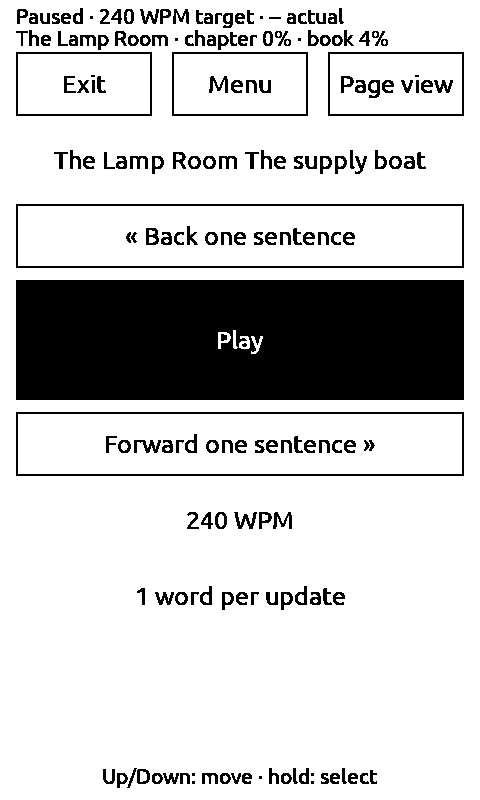

*Simulator picture of the speed-reading pause screen (RSVP). The top line shows the target and the actual pace. The real screen is e-ink.*

*Simulator picture of a checkpoint question, before the answer is shown. The real screen is e-ink.*

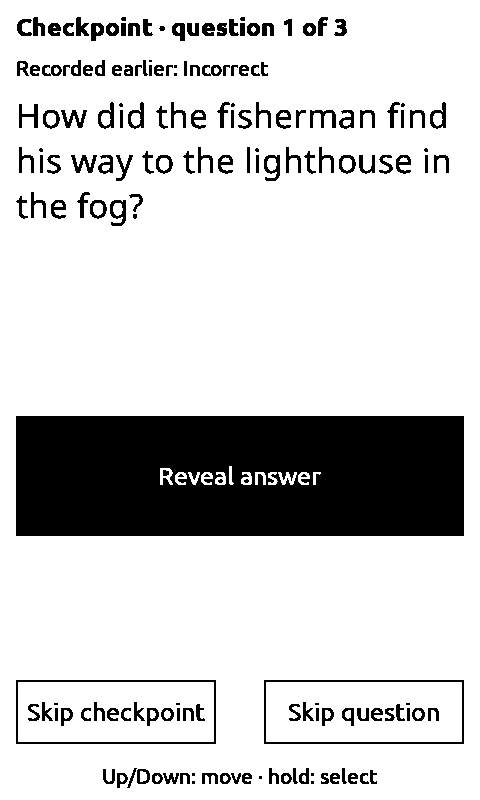

*Simulator picture of a question from an earlier pass, with "Recorded earlier". The real screen is e-ink.*

*Simulator picture of the banner at a picture in an ordinary book. The real screen is e-ink.*

## Appendix C: what this session tells us

The open questions of the plan and the design notes, and where each answer ends up.

| Question | Where the answer is recorded |
| --- | --- |
| Which panel this Picco has (YRD0426, DEPG0397, OPM040B3, SE0400NQW47) | Serial log line `[EPD] Picco panel`; Device test menu; every `/rsvp-bench/` file (`device.panel`); results sheet, step 6 |
| Real partial and full refresh times, word band and full screen | `NNNN-bench.json` (each profile's word band, full-screen and clearing steps); serial log `[DTS] result` lines |
| Whether a shortened waveform stays readable after 30 to 60 and 300 updates | `NNNN-bench.json` ratings and residue answers; results sheet, step 9 |
| Flash size and PSRAM as the chip reports them | The summary file (identify's checks) |
| Which key is Up (GPIO21) and which is Down (GPIO9); whether GPIO5 (Confirm) is a key; whether a 0.7 s hold is comfortable | `NNNN-controls.json`; results sheet, step 7 |
| Whether a short power click works without sleeping | `NNNN-controls.json` (`power_clicked`); results sheet, step 7 |
| Whether 64 px touch targets are easy to hit, and touch near the edges | Results sheet, "How it felt" |
| How often a grip or palm touch pauses speed reading by mistake | Results sheet, "How it felt" |
| Whether moving the highlight feels quick enough, and whether the highlight stays visible | Results sheet, "How it felt" |
| The slide switch's "on" direction | Results sheet, "How it felt" |
| Whether the panel's BUSY signal and the timeouts behave as the SDK assumes | Serial log (timeouts in `[DTS] result` lines); `NNNN-bench.json` (`timeouts`) |
| Whether the last frame stays unchanged until you press, and whether 15 s per rating is enough | Results sheet, step 9 |
| The guided acceptance's measured figures, your answers, and each Part B step | `NNNN-acceptance.json`; results sheet, step 10 |
| Whether the on-screen instructions are clear enough to follow alone, and how long the walk-through took | Results sheet, step 10 |
| Whether the PC reaches the stock Picco over USB, and esptool's reset into download mode works | Summary file (identify); results sheet, steps 2 and 3 |
| How long a 16 MB read and the flash take over USB | Results sheet, steps 3 and 5 |
| Whether the Picco returns to normal after identify and backup, and starts the new firmware after the flash | Results sheet, steps 2, 3 and 6; serial log |
| The real eFuses, flash type and Onyx's bootloader and partition table | Summary file |
| Whether the guard accepts the real images | Results sheet, step 5 (and the summary's command list) |
| Whether the COM port stays the same after restarts, and how `monitor -Reset` behaves on Windows | Results sheet, "PC and tool" |
| `session.ps1` and the private Python on this PC: PowerShell version, antivirus, network | Results sheet, "PC and tool" |
| Whether the SD-card update works and the Picco then runs from the second slot | Serial log `[UPD]` line; results sheet, step 8 |
| The profile chosen for reading | `NNNN-choice.json`; results sheet, step 11 |

## Appendix D: mapping to the plan

Every step and every stop condition of `docs/PLAN.md` section 10, and the part of this sheet that covers it.

| Plan section 10 | This sheet |
| --- | --- |
| The device kit | [Before the session day](#before-the-session-day): "Get the kit", "Check the download", "Extract the kit", "What is in the kit folder" |
| Step 1. **Prepare.** | [Step 1](#step-1-prepare), lines 1 to 5 (charge, note the Onyx version, Home screen, cable, setup) |
| Step 2. **Identify (read-only).** | [Step 2](#step-2-identify-read-only), lines 1 to 4 and the table "Other results" |
| Step 3. **Back up (read-only).** | [Step 3](#step-3-back-up-read-only), lines 1 to 9 (two reads, copy to a second place, confirm) |
| Step 4. **Confirm.** | [The gate](#the-gate-before-the-first-change), lines 1 to 8; [Step 4](#step-4-confirm), lines 1 to 7 (dry run, plan, phrase `REPLACE ONYX`) |
| Step 5. **Flash.** | [Step 5](#step-5-flash), lines 1 to 4 and "If it goes differently" |
| Step 6. **First boot.** | [Step 6](#step-6-first-boot), lines 1 to 3 (serial log), 4 to 7 (Home screen, panel, version, slot), 8 to 16 (copy the `sd-card` files) |
| Step 7. **Controls check.** | [Step 7](#step-7-controls-check), lines 1 to 15 (each key, holds, power, touch; Side buttons layout; Short click Confirm; results sheet) |
| Step 8. **Prove the update path (optional).** | [Step 8](#step-8-prove-the-update-path-optional), lines 1 to 7; Wi-Fi update note |
| Step 9. **Display benchmark.** | [Step 9](#step-9-display-benchmark), "What the times are", "What the ratings mean", "Run it", lines 1 to 11 |
| Step 10. **Guided acceptance.** | [Step 10](#step-10-guided-acceptance), Part A lines 1 to 8, Part B lines 1 to 7; [Appendix A](#appendix-a-the-twelve-steps-of-part-b) |
| Step 11. **Choose a profile.** | [Step 11](#step-11-choose-a-profile), lines 1 to 7 |
| Step 12. **Return evidence.** | [Step 12](#step-12-return-evidence), lines 1 to 11; template `device-session-results.md` |
| Steps 2 and 3 may be run earlier | [If you already did the early check](#if-you-already-did-the-early-check) |
| Benchmark sweep, per display profile | [Step 9](#step-9-display-benchmark) (temperature, ratings Clean, Tolerable or Unreadable, residue, files and serial log) |
| The PRD's on-device criterion | [Step 10](#step-10-guided-acceptance), Part A lines 3 to 8; Appendix A, step 12 |
| Stop: Identify finds a different chip, flash size or layout | [Step 2](#step-2-identify-read-only), line 4; "Other results" (`ALREADY CONVERTED`) |
| Stop: Identify finds Secure Boot, flash encryption, restricted download mode, octal flash, or a partition table that differs from `partitions_picco.csv` | [Step 2](#step-2-identify-read-only), line 4 |
| Stop: The two backup hashes differ | [Step 3](#step-3-back-up-read-only), "If it goes differently", first row; [The gate](#the-gate-before-the-first-change), line 2 |
| Stop: Flashing fails part-way or the device does not boot | [Step 5](#step-5-flash), "If it goes differently"; [Recovery: flashing stops part-way](#flashing-stops-part-way); [Recovery: the Picco does not start](#the-picco-does-not-start-after-done) |
| Stop: The home screen appears but touch or keys are wrong | [Recovery: touch or keys are wrong](#touch-or-keys-are-wrong); [Step 7](#step-7-controls-check), lines 12 to 15 |
| Stop: A trial profile leaves heavy residue | [Step 9](#step-9-display-benchmark), "Heavy residue", lines 1 to 3 |

## Appendix E: results sheet

Fill this in during the session. The results issue has the same fields.

**Before and steps 1 to 3**

* Kit version: ____________   Date: ____________   Sittings: one / two
* Onyx firmware version (step 1): ____________
* Identify result (step 2): PASS / STOP / ALREADY CONVERTED / not reached. Notes: ____________
* Did the Picco's screen freeze or restart during identify? ____________
* Backup (step 3): verified (two identical reads)? yes / no. Size: ____________ bytes. Time for the two reads: ______ min
* Backup copied to a second place and checked? yes / no. (Never write the file itself into the issue.)

**Steps 4 to 6**

* Dry run: READY / NOT READY
* Flash (step 5): DONE / did not complete / not started. Time: ______ min
* If it did not complete: what the window showed, and the restore result: ____________
* First boot (step 6): Home screen appeared? yes / no, after about ______ seconds. Needed the power button? yes / no
* Panel (from `[EPD] Picco panel`): ____________   Version in Settings: ____________   `running` slot: ____________
* Books copied by: File Transfer / card reader. Can the SD card be taken out? yes / no / did not check

**Step 7: Controls check**

* `BTN_UP` key is: ____________   `BTN_DOWN` key is: ____________
* `BTN_CONFIRM`: none / the ____________ key. Anything firing by itself? ____________
* Short power press recorded without sleep? yes / no. 0.7 s hold comfortable? yes / no
* Settings changed: Layout (reader only) = ____________; Short click = ____________

**Step 8 (optional)**

* Done? yes / no / skipped. After the update, `running` = ____________. Messages: ____________

**Step 9: Display benchmark**

* Room temperature: ______ °C or unknown. Battery at start: ______ %
* Profiles run: ____________   Not run, and why: ____________
* Residue seen on: ____________. Rated "Unreadable, skip rest of profile": ____________
* Did the last frame stay unchanged until you pressed? yes / no. Was 15 s per rating enough? yes / no
* File: /rsvp-bench/____________-bench.json

**Step 10: Guided acceptance**

* Part A: delivered WPM at 240: ______, at 600: ______. Automatic check: Pass / Fail. Your answers: Pass / Fail
* Part B: step results are in the table of Appendix A. Failed steps and what you saw: ____________
* Were the instructions clear enough? ____________   Time taken: ______ min
* File: /rsvp-bench/____________-acceptance.json

**Step 11**

* Profile chosen: ____________   Kept: ____________   File: /rsvp-bench/____________-choice.json

**How it felt (from the whole session)**

* Touch targets easy to hit? Near the edges? ____________
* Did a grip or palm touch pause speed reading by mistake? How often? ____________
* Moving the highlight: quick enough? Highlight easy to see? ____________
* Slide switch: which direction is "on"? ____________

**PC and tool**

* Windows version: ____________   PowerShell window title or version: ____________
* COM port: ______. Did it change after a restart? yes / no
* Antivirus or network problems: ____________
* Anything that went wrong, and what you did: ____________

## Appendix F: files and exit codes

Everything the tool makes is in the kit folder's `work` folder:

| File | What | Share? |
| --- | --- | --- |
| `identify-<time>.json` and three `identify-...bin` files | What identify read | **No** (keep private) |
| `picco-backup-<...>.bin` and `.json` | The backup | **No.** Keep a copy on the USB stick |
| `picco-backup-<...>-MISMATCH.json` and `.read1.bin`, `.read2.bin` | Only after two backup reads differed | **No** |
| `flash-result-<time>.json` | What the flash wrote and verified | No need: the summary holds it |
| `serial-<time>.log` | The serial log, one file for each `monitor` start | **Yes**, after the Wi-Fi name check (step 12) |
| `logs\<command>-<time>.log` | Everything each command showed, with full paths and the full MAC | **No** |
| `session-summary-<time>.txt` | The summary (older kits named it `early-check-summary-<time>.txt`) | **Yes** |

The last line of every command is `[exit N: NAME]`:

| N | Meaning |
| --- | --- |
| 0 | worked |
| 1 | stopped or refused; nothing was written |
| 3 | identify: already converted |
| 4 | the Picco could not be reached; nothing was written |
| 5 | the flash started writing and did not finish: run the restore |
| 6 | the restore did not finish: run the restore again |
| 10, 11, 12 | the setup of the private Python failed; the Picco was not touched |
