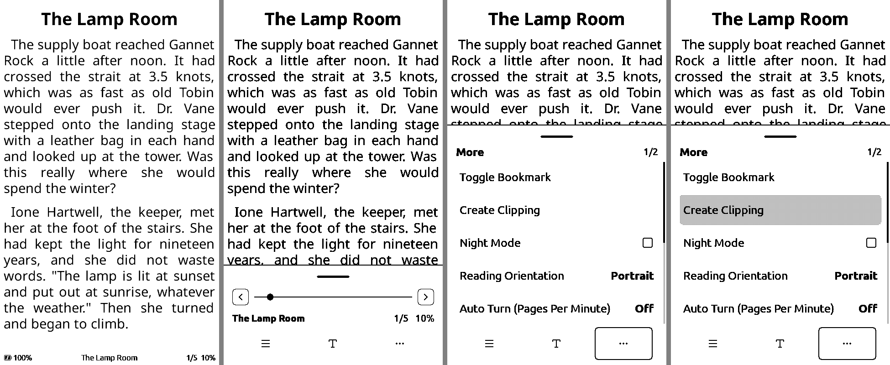
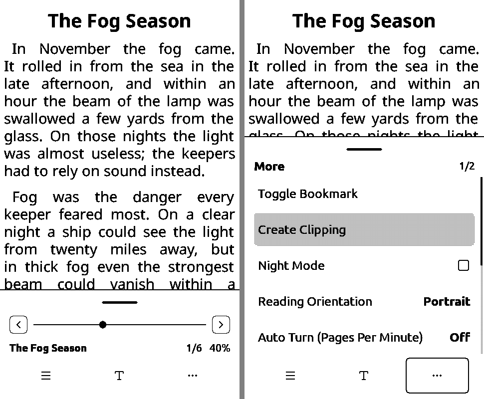

# Spike S4: Picco input roles and control map

Issue #12. This is the input contract for the RSVP tasks (R4a, R4b, R5), the checkpoint tasks (C3, C4), the device test screens (D3a, D3b) and the scenario harness (E2). Nothing here changes firmware. Line numbers refer to `origin/main` at `378f9471` (pinned base `490813ff` plus project work) and to `crosspoint-simulator` at `84c3421d` (written `sim:` below).

## Answer in short

- **What the firmware sees on the Picco.** Two side keys, `Up` (GPIO21) and `Down` (GPIO9). The SDK marks both as confirmed on hardware. A third input, GPIO5, is carried as `Confirm`, but its physical role is "unconfirmed". The power button (GPIO2) sleeps when held for 0.4 s. A slide switch (GPIO6) is read as a level. Touch is single-contact as the firmware uses it: tap, long-press after 0.5 s, swipes in four directions, and edge swipes. There is no Back key, no Left/Right key and no Home key (section 3).
- **Today, on the Picco, the keys reach very little.** In page view, `Up` and `Down` turn pages. The reader menu opens only with `Confirm` or a centre tap. Inside upstream menus and lists, only `Confirm` can activate a row (`src/activities/UiListActivity.cpp:142-146`). In the toolbar menu, which is the Picco's default, `Up` and `Down` jump chapters (`src/activities/reader/EpubReaderActivity.cpp:2965-2968`). If GPIO5 turns out not to be a key, a person using only keys cannot open or use any upstream menu. The new screens must therefore not depend on `Confirm` (section 4.4).
- **Key-path scheme, in three lines:**
  1. A **short press** of a side key (released before 0.7 s) moves the highlight: `Up` to the previous item, `Down` to the next. It never activates anything. The highlight does not wrap.
  2. **Holding either side key for 0.7 s** activates the highlighted item. Steppers repeat every 0.4 s while the key stays down. `Confirm` (GPIO5), if it exists, also activates. The power button is used only when upstream's "Short power button: Confirm" setting turns it into `Confirm`.
  3. **During RSVP playback**, the first key press or the first touch anywhere pauses. In page view, **holding a side key for 0.7 s** enters RSVP. This uses a new "Page turn long press: Speed read" option, which is the default in feature builds.
- **Every action in the brief has a touch target and a key path that uses only the two side keys** (section 1). The default highlight on every screen is the safe action. "Skip checkpoint" is always the last item and sits at the bottom left. A grade is never the default.
- **One table** (`src/controls/ControlMap.h`, sketch in section 7) holds the key roles, timings, event-to-action bindings and touch zones. A swapped pair of side keys can be fixed in two ways. During the session, the owner changes an existing setting on the device, which fixes page view and the new screens at once. Afterwards, a one-line table edit ships in the SD update. No run-time override file is recommended.

## 1. Control map

Portrait layout, 480x800 logical pixels. Zones are `x,y,w,h`. "Hold" means holding either side key for at least 0.7 s, which activates the highlighted item. "Down×2" means two short presses of `Down`, counted from the default highlight. In the key path, `Confirm` can always replace "hold", and it is never required. **Bold** marks the default highlight.

| # | Screen / state | Action | Touch target | Key path (side keys only) | Notes |
| --- | --- | --- | --- | --- | --- |
| 1 | Page view, RSVP available | Enter RSVP at the current position | Centre-third tap (160-319, 267-532) opens the toolbar menu. Tap `…` (More, ~385,752), then the first row, "Speed read" | Hold `Down` or `Up` 0.7 s | Lands on the pause screen (rows 3-14) with Play highlighted. A short press still turns the page, on release |
| 2 | RSVP playing | Pause | Touch-down anywhere (whole screen) | Press of any key, on the press edge | The rest of that touch, and the release of that key, are swallowed. Edge gestures cannot fire (section 5.1) |
| 3 | Pause screen | Play / resume | **Play** 16,280,448,120 | Hold | |
| 4 | Pause screen | Back one sentence | 16,204,448,64 | Up×1, hold (repeats) | |
| 5 | Pause screen | Forward one sentence | 16,412,448,64 | Down×1, hold (repeats) | |
| 6 | Pause screen | WPM down | `−` 16,488,96,64 | Down×2, hold (repeats) | 20 WPM steps, 60 to 1000 |
| 7 | Pause screen | WPM up | `+` 368,488,96,64 | Down×3, hold (repeats) | |
| 8 | Pause screen | Words per update down | `−` 16,564,96,64 | Down×4, hold | 1 to 4 (`lib/RsvpCore/FrameBuilder.h:15`) |
| 9 | Pause screen | Words per update up | `+` 368,564,96,64 | Down×5, hold | |
| 10 | Pause screen | Save as global default | 16,640,216,64 | Down×6, hold | Status line confirms "Saved as default" |
| 11 | Pause screen | Save as this book's override | 248,640,216,64 | Down×7, hold | |
| 12 | Pause screen | Switch to page view at the same position | Page view 328,52,136,64, or a left-edge swipe (Back) | Up×2, hold (Up×3 during a reread) | |
| 13 | Pause screen | Reader menu | Menu 172,52,136,64 | Up×3, hold (Up×4 during a reread) | Opens upstream's menu. Its rows need touch or `Confirm` (section 4.4) |
| 14 | Pause screen | Exit the book | Exit 16,52,136,64 | Up×4, hold (Up×5 during a reread) | Goes Home. Position and mode are saved |
| 15 | RSVP stopped at a non-prose item (page view with a banner) | Continue RSVP after the item | **Continue** 16,688,264,72 | Hold | Starts playing from the word after the item |
| 16 | Same | Stay in page view | Stay 304,688,160,72, or a left-edge swipe | Down×1, hold | Removes the banner. Normal page view follows |
| 17 | Prompt (answer hidden) | Reveal answer | **Reveal** 16,416,448,120 | Hold | |
| 18 | Prompt | Skip prompt | Skip question 264,680,200,64 | Down×1, hold | |
| 19 | Prompt | Skip checkpoint | Skip checkpoint 16,680,200,64 | Down×2, hold | Last item, bottom left |
| 20 | Answer revealed | Page a long answer | **Answer box** 16,120,448,440: a tap shows the next part. A swipe up or down inside the box shows the next or previous part | Hold (cycles through the parts) | A part counter "1/2" sits in the box. On a one-part answer, a hold does nothing |
| 21 | Answer revealed | Correct | 16,576,208,88 | Down×1, hold | Never the default |
| 22 | Answer revealed | Incorrect | 256,576,208,88 | Down×2, hold | |
| 23 | Answer revealed | Skip prompt | 264,680,200,64 | Down×3, hold | |
| 24 | Answer revealed | Skip checkpoint | 16,680,200,64 | Down×4, hold | |
| 25 | After Incorrect | Reread in RSVP | 16,216,448,80 | Hold if it is the default, else Up×1, hold | The default is the reread in the mode in use when the checkpoint appeared |
| 26 | After Incorrect | Reread in page view | 16,308,448,80 | Hold if it is the default, else Down×1, hold | |
| 27 | After Incorrect | Continue | 16,400,448,80 | Down×1 or ×2, hold | Same transition as Skip prompt (`lib/CheckpointCore/README.md:208`) |
| 28 | After Incorrect | Skip prompt | 264,680,200,64 | Down×2 or ×3, hold | |
| 29 | After Incorrect | Skip checkpoint | 16,680,200,64 | Down×3 or ×4, hold | |
| 30 | Reread in RSVP | Return early | Any touch pauses, then tap "↩ Back to the question" at 16,128,448,64 | Any key pauses, then Up×2, hold | The pause screen gains this row. All of rows 2-14 still apply |
| 31 | Reread in page view | Return early | "↩ Back to the question" in a top bar, 248,4,216,64 | Hold opens a short list whose default row is "Back to the question". Hold again | A short press turns pages as usual. Reading past the section end returns by itself. Superseded (task C4): see src/activities/rsvp/README.md |
| 32 | Back at the prompt after a reread | Retry / continue / skip | Same as rows 17-19 | Same as rows 17-19 | "Retry" is Reveal. "Continue" is Skip prompt (`lib/CheckpointCore/README.md:321`) |
| 33 | Checkpoint finished or skipped | none | RSVP: the pause screen at the first word after the break, Play highlighted, status line "Checkpoint done". Page view: the page holding that word, nothing added | | Nothing advances by itself (`lib/CheckpointCore/README.md:224`) |
| 34 | Device test lists (benchmark, ratings, pass/fail, profile choice) | Choose a row | Rows 448x72 from y=72, 8 px apart. Tap a row | Short press moves, hold chooses | The default row never commits anything: "Show again", "Repeat step" or the current profile |

Every new screen carries a one-line hint at the bottom (y 752-800): "Up/Down: move · hold: select". Upstream's footer hints are not drawn on touch boards (`src/components/themes/BaseTheme.cpp:217-221`), so the hint has to be drawn by our screens.

## 2. Wireframes

Portrait 480x800. Boxes are touch targets, `[[ ]]` is the default highlight, and numbers are y ranges.

**Pause screen.** Row R1b shows the last words in normal mode and becomes a button during a reread.

```
  0 ┌──────────────────────────────────────────────┐
    │ Paused · 240 WPM target · 124 actual · 42%    │ status, not a target
 52 │ ┌──────────┐ ┌──────────┐ ┌──────────┐        │
    │ │  Exit    │ │  Menu    │ │Page view │        │ 64 high
116 │ └──────────┘ └──────────┘ └──────────┘        │
128 │ "…the colonies were" (normal) /               │
    │ ┌ ↩ Back to the question ───────────────────┐ │ (reread only)
192 │ └───────────────────────────────────────────┘ │
204 │ ┌ « Back one sentence ──────────────────────┐ │
268 │ └───────────────────────────────────────────┘ │
280 │ ╔═══════════════════════════════════════════╗ │
    │ ║                 ▶  Play                   ║ │ default, 120 high
400 │ ╚═══════════════════════════════════════════╝ │
412 │ ┌ Forward one sentence » ───────────────────┐ │
476 │ └───────────────────────────────────────────┘ │
488 │ ┌──┐        240 WPM                    ┌──┐ │
    │ │ −│                                    │ +│ │
552 │ └──┘                                    └──┘ │
564 │ ┌──┐     1 word per update             ┌──┐ │
628 │ └──┘                                    └──┘ │
640 │ ┌ Save as default ───┐ ┌ Save for this book ┐ │
704 │ └────────────────────┘ └────────────────────┘ │
752 │ Up/Down: move · hold: select                  │
800 └──────────────────────────────────────────────┘
Focus order: Exit, Menu, Page view, [Back to the question], « sentence, PLAY,
sentence », WPM −, WPM +, words −, words +, Save default, Save book.
```

**Prompt, answer hidden.**

```
  0 ┌──────────────────────────────────────────────┐
    │ Checkpoint · question 1 of 2                  │
 48 │ Recorded earlier: Incorrect   (only if any)   │
 88 │ Prompt text, up to 300 characters, wrapped    │
    │ ...                                           │
416 │ ╔═══════════════════════════════════════════╗ │
    │ ║              Reveal answer                ║ │ default
536 │ ╚═══════════════════════════════════════════╝ │
    │            (empty, 144 px)                    │
680 │ ┌ Skip checkpoint ┐       ┌ Skip question ──┐ │
744 │ └─────────────────┘       └─────────────────┘ │
752 │ Up/Down: move · hold: select                  │
    └──────────────────────────────────────────────┘
Focus order: REVEAL, Skip question, Skip checkpoint.
```

**Answer revealed.** The answer box covers the area where Reveal was, so a second tap on Reveal lands on the answer, never on a grade.

```
  0 ┌──────────────────────────────────────────────┐
    │ Checkpoint · question 1 of 2                  │
 48 │ Prompt, shortened to 2 lines…                 │
120 │ ╔═══════════════════════════════════════ 1/2 ╗ │
    │ ║ Reference answer, up to 600 characters,  ║ │ default; tap = next part
    │ ║ about 16 lines per part                   ║ │ swipe up/down = next/prev
560 │ ╚═══════════════════════════════════════════╝ │
576 │ ┌ ✓ Correct ────────┐   ┌ ✗ Incorrect ───────┐│ 88 high, 32 apart
664 │ └───────────────────┘   └────────────────────┘│
680 │ ┌ Skip checkpoint ┐       ┌ Skip question ──┐ │
744 │ └─────────────────┘       └─────────────────┘ │
752 │ Up/Down: move · hold: select                  │
    └──────────────────────────────────────────────┘
Focus order: ANSWER BOX, Correct, Incorrect, Skip question, Skip checkpoint.
```

**After Incorrect.** The area where Correct and Incorrect were is empty, so a double tap on a grade lands on nothing.

```
  0 ┌──────────────────────────────────────────────┐
    │ Question 2 of 2 · marked Incorrect            │
 56 │ Reread the section, then try again.           │
    │ Prompt, 2 lines…                              │
216 │ ╔ Reread in RSVP ═══════════════════════════╗ │ default if the
296 │ ╚═══════════════════════════════════════════╝ │ checkpoint came from RSVP
308 │ ┌ Reread in page view ──────────────────────┐ │ default if it came
388 │ └───────────────────────────────────────────┘ │ from page view
400 │ ┌ Continue ─────────────────────────────────┐ │
480 │ └───────────────────────────────────────────┘ │
    │            (empty, 200 px)                    │
680 │ ┌ Skip checkpoint ┐       ┌ Skip question ──┐ │
744 │ └─────────────────┘       └─────────────────┘ │
752 │ Up/Down: move · hold: select                  │
    └──────────────────────────────────────────────┘
Focus order: Reread RSVP, Reread page, Continue, Skip question, Skip checkpoint.
```

**Non-prose stop.** Page view shows the item, with a banner over the bottom.

```
  0 ┌──────────────────────────────────────────────┐
    │   (page view: the image, table or code)       │
    │                                               │
632 ├──────────────────────────────────────────────┤
    │ Image. Speed reading stopped here.            │
688 │ ╔ ▶ Continue speed reading ═╗  ┌ Stay in ───┐ │ 72 high
    │ ║                           ║  │ page view  │ │
760 │ ╚═══════════════════════════╝  └────────────┘ │
    │ Up/Down: move · hold: select                  │
    └──────────────────────────────────────────────┘
Focus order: CONTINUE, Stay in page view.
```

**Reread in page view.** A top bar is drawn over the page.

```
  0 ┌──────────────────────────────────────────────┐
    │ Rereading this section  ┌ ↩ Back to the    ┐  │ 248,4,216,64
 72 │                         └   question       ┘  │
    │   (normal page; side keys turn pages,         │
    │    hold opens: [[Back to the question]],      │
    │    Speed read from here, Keep reading)        │
    └──────────────────────────────────────────────┘
```

**Generic list of choices** (device test, reread options):

```
  0 ┌──────────────────────────────────────────────┐
    │ Rate this profile                             │ header, 0-56
 72 │ ╔ Show the passage again ═══════════════════╗ │ default, non-committing
    │ ┌ Clean ────────────────────────────────────┐ │ 448x72 rows, 8 apart
    │ ┌ Tolerable ────────────────────────────────┐ │
    │ ┌ Unreadable ───────────────────────────────┐ │
752 │ Up/Down: move · hold: select                  │
    └──────────────────────────────────────────────┘
```

### Target sizes

The Picco's panel is 800x480 on a 3.97" diagonal: 933 px over 3.97 in, about 235 ppi or 9.25 px/mm. FreeInkUI's default minimum target is 44 px (`freeink-sdk/libs/ui/FreeInkUI/include/FreeInkUICore.h:136`, `:646`), about 4.8 mm. That is small for a finger on a pocket device, so this map uses:

- at least 64 px high (about 6.9 mm) and 96 px wide for any target, and 120 px high for the default primary action (Play, Reveal);
- at least 12 px between ordinary targets;
- at least 32 px around Correct, Incorrect and Skip checkpoint. They never share a row with the default, and Skip checkpoint sits at the left. In upstream's tap mode the left third is the previous-page zone (`src/activities/reader/ReaderUtils.h:133-137`), which a habitual next-page tap does not use;
- nothing in the top or bottom 14% that needs a swipe. Taps there are fine. Swipes starting there are the global light-panel and Home gestures (section 5.1).

## 3. Inputs the firmware sees on the Picco

| Physical (as far as known) | SDK logical | Firmware event (`MappedInputManager`) | Simulator keyboard / mouse | Script token |
| --- | --- | --- | --- | --- |
| Side key on GPIO21, "confirmed on hardware" (`freeink-sdk/libs/hardware/BoardConfig/include/BoardConfig.h:1802`, `:1831-1835`) | `BTN_UP` (index 4, `freeink-sdk/libs/hardware/InputManager/include/InputManager.h:68`) | `Button::Up`. In portrait with the default layout it is also `PageBack` and `NavPrevious` (`src/MappedInputManager.cpp:198-200`, `:207-211`, `:238-240`) | Up arrow (`sim:src/HalGPIO.cpp:54`) | `UP`, `UP:<ms>` (`sim:src/HalGPIO.cpp:379-380`, `:476-488`) |
| Side key on GPIO9, "confirmed on hardware" | `BTN_DOWN` (index 5) | `Button::Down`, `PageForward`, `NavNext` (`src/MappedInputManager.cpp:201-203`, `:221-225`, `:235-237`) | Down arrow (`sim:src/HalGPIO.cpp:55`) | `DOWN`, `DOWN:<ms>` |
| GPIO5, "physical role unconfirmed" (`BoardConfig.h:1832-1835`) | `BTN_CONFIRM` (index 1) | `Button::Confirm` through `SETTINGS.frontButtonConfirm` (`src/MappedInputManager.cpp:189-191`, `src/CrossPointSettings.h:320`) | Return (`sim:src/HalGPIO.cpp:51`). The simulator "does not establish the physical GPIO5 mapping" (`sim:docs/picco.md:21-24`) | `ENTER`, `RETURN`, `CONFIRM` (`sim:src/HalGPIO.cpp:373-374`) |
| Power button, GPIO2, active low, wake source (`BoardConfig.h:1831`) | `BTN_POWER` (index 6) | Held more than 0.4 s: deep sleep from `main.cpp`. Short click: the "Short power button" setting (section 4.3) | P (`sim:src/HalGPIO.cpp:56`). S simulates sleep (`:40`) | `POWER`/`P` (short = 80 ms; `POWER:600` sleeps), `SLEEP`/`S` (`sim:src/HalGPIO.cpp:383-384`, `:441-442`) |
| Slide switch, GPIO6, "on" = LOW (`BoardConfig.h:628-630`, `:1808`) | level `isToggleSwitchOn()`, edge `wasToggleSwitchChanged()` (`InputManager.h:218-225`) | Not a button. `handleSlideSwitch()` applies it to frontlight, night mode or touch controls (`src/main.cpp:222-254`) | T (`sim:src/HalGPIO.cpp:42`) | `SWITCH_ON`, `SWITCH_OFF` (`sim:src/HalGPIO.cpp:419-422`) |
| Touch, Parade TMA525C at I2C 0x24, `synthesizeConfirm` false, no home key (`BoardConfig.h:1843-1844`, `:668-671`) | tap, touch-down, held, long-press after 500 ms, swipe of at least 60 px within 700 ms, tap slop 28 px (`InputManager.h:544-551`) | `wasScreenTapped`, `wasScreenTouchPressed`, `wasScreenLongPress`, `wasSwipe` (`src/MappedInputManager.h:91-120`); edge gestures fold into Back, Home and the light panel (section 5.1) | Left mouse button: press, drag, release (`sim:src/HalGPIO.cpp:780-805`). Same thresholds (`sim:src/HalGPIO.cpp:43-46`) | `TAP:x,y[,ms]` (`ms` of 500 or more = long-press), `SWIPE:x1,y1,x2,y2[,ms]` (`sim:src/HalGPIO.cpp:461-475`, `:281-313`) |
| Multi-touch | The SDK can report up to 4 contacts on a Picco whose controller confirms it (`InputManager.h:103`, `:117-120`; `InputManager.cpp:2355-2375`) | Unused: nothing under `src/` reads it | Not available (one mouse pointer) | none |
| Back, Left, Right keys | `PIN_UNASSIGNED` (`BoardConfig.h:1835`) | `Button::Back` arrives only from a left-edge swipe or the header back button (`src/MappedInputManager.cpp:406-425`, `:462`) | Escape and Left/Right are disabled on Picco (`sim:src/HalGPIO.cpp:327-330`) | `BACK`, `LEFT`, `RIGHT` parse, but the simulator drops them on Picco |
| Home key | none (`hasHomeKey` false) | `wasHomeGesture()` is the bottom-edge up-swipe (`src/MappedInputManager.cpp:435-437`) | H has no effect | `HOME` has no effect (`sim:src/HalGPIO.cpp:254-256`) |
| Cover page keys | none | none | none | `PREV`/`NEXT` do nothing on Picco (`sim:src/HalGPIO.cpp:341-344`, `:443-452`) |
| Tilt (QMI8658 IMU) | `halTiltSensor` | Page turn only if "Tilt page turn" is on. It is off by default (`src/activities/reader/ReaderUtils.h:68-69`) | no measurements (`sim:docs/picco.md:31-33`) | none |

Other script tokens: `WAIT:<regex>` (waits for a log line), `SHOT:<path>`, `QUIT` (`sim:src/HalGPIO.cpp:423-440`). Times count from start-up or from the last matched WAIT, and are absolute within one segment, not cumulative (`sim:README.md:247`). A coordinate between 0 and 1 is read as a normalised fraction (`sim:src/HalGPIO.cpp:302-303`), so scripts must never use the pixel value `1`.

## 4. How an activity receives input today

### 4.1 API and edge semantics

The main loop updates `MappedInputManager` once per pass, then calls `ActivityManager::loop()`. Activities read that snapshot (`.agents/rules/ui-activities.md:40-45`). Activities must use logical `MappedInputManager::Button`s, never raw `HalGPIO` indices (`.agents/rules/ui-activities.md:33-38`).

- `wasPressed()`: press edge this pass. `wasReleased()`: release edge. `isPressed()`: level (`src/MappedInputManager.cpp:455-514`).
- `wasLongPressed(btn, ms)`: fires once while the key is still down. It suppresses the release that follows, and `ActivityManager::loop()` consumes that release before any activity runs (`src/MappedInputManager.cpp:486-512`, `src/activities/ActivityManager.cpp:106`). This is exactly what "short = move, hold = select" needs.
- Repeat: `ButtonNavigator` repeats a held navigation key after 500 ms, every 500 ms (`src/util/ButtonNavigator.h:21-22`, `src/util/ButtonNavigator.cpp:55-82`).
- Touch: `wasScreenTapped` (on release, within slop), `wasScreenTouchPressed` (touch-down edge), `wasScreenLongPress` (fires while the finger is down and suppresses the rest of the contact), `isScreenTouchHeld`, `wasSwipe` (`src/MappedInputManager.cpp:264-319`, `:370-390`). `HalGPIO::suppressTouchContact()` ignores the rest of a contact (`lib/hal/HalGPIO.h:125`).
- Remote: Bluetooth page-turner clicks are injected as `Confirm`, `Back`, `NavNext/Right` and `NavPrevious/Left` (`src/MappedInputManager.cpp:449-460`). This happens only while the current activity returns `acceptsRemoteInput()` (`src/activities/ActivityManager.cpp:416-426`).

### 4.2 Touch zones

New screens should use FreeInkUI through `UiAppHost` or `UiListActivity`. Hit-testing comes from the interaction table the render publishes, and hand-written rectangle checks are legacy (`docs/contributing/touch-and-ui.md:5-21`, `:126-139`). Interactions carry an input mask (`InputTouch`, `InputFocus`, `InputConfirm`, `InputPrev`, `InputNext`, `InputLongPress`, `InputDrag`: `FreeInkUICore.h:293-308`). `UiListActivity` exposes the hooks a two-key list needs: `navigateButtons()`, `handleButtons()` and `handleCustomInput()` are virtual (`src/activities/UiListActivity.h:64-71`). Upstream's own `handleButtons()` activates only on `Confirm` (`src/activities/UiListActivity.cpp:137-147`). Its `navigateButtons()` moves on the press edge and repeats while held (`:192-210`), which would fight a "hold to select" gesture. Our list therefore overrides both. The zones in section 1 are the rectangles the new screens register, kept as data in the table (section 7).

### 4.3 The reader on the Picco today

| Function | Keys | Touch |
| --- | --- | --- |
| Next / previous page | `Down` / `Up` (`PageForward`/`PageBack`, default layout Prev/Next: `src/CrossPointSettings.h:314`). The page turns on the **press** edge while "Page turn long press" is Off, the default (`src/CrossPointSettings.h:353`; `src/activities/reader/ReaderUtils.h:66-85`) | Swipe left / right. The default gesture is swipe only (`src/CrossPointSettings.h:406-407`; `ReaderUtils.h:93-108`). Tap zones exist only in tap modes (`ReaderUtils.h:110-139`) |
| Open the reader menu | `Confirm` release (`src/activities/reader/EpubReaderActivity.cpp:1005-1016`), or a short power click if "Short power button: Reader menu" (`src/MappedInputManager.cpp:93-109`; `EpubReaderActivity.cpp:979-984`) | Tap in the centre third (`ReaderUtils.h:142-158`). The top-edge down-swipe would also qualify (`ReaderUtils.h:164-173`), but `ActivityManager` takes it first for the light panel (section 5.1) |
| Reader menu style | Touch boards default to the **toolbar** overlay (`src/main.cpp:641-648`). Its `Up`/`Down` jump chapters, Left/Right (absent here) move between tools, `Confirm` opens a tool, Back closes (`EpubReaderActivity.cpp:2919-2968`). Its More panel reuses `EpubReaderMenuActivity::buildMenuItems` (`EpubReaderActivity.cpp:3184`) | Tap a tool, a row, or the page above the sheet to dismiss (`EpubReaderActivity.cpp:2922-2924`) |
| Back / exit | No Back key. The reader surface ignores the left-edge back swipe on purpose (`ReaderUtils.h:270-279`). Exit is "Go Home" in the menu | Bottom-edge up-swipe goes Home (`src/activities/ActivityManager.cpp:119-126`) |
| Long press | Upstream's Confirm long-press shortcuts are disabled on touch boards (`EpubReaderActivity.cpp:1382-1384`). Side-key long press does a chapter skip or orientation change only if that setting is chosen (`EpubReaderActivity.cpp:1083-1101`) | Touch long-press starts clip selection (`EpubReaderActivity.cpp:857-861`) |

The screenshots confirm the touch path and the key limits in the simulator. `s4/reader-touch-path.png` shows, from left to right: page view; a centre tap opening the toolbar; the More panel after tapping `…`; and `DOWN` moving the More-panel highlight. `s4/reader-side-keys.png` shows `DOWN` in the toolbar loading the next chapter ("The Fog Season"), and a 1.5 s `DOWN` hold in the More panel moving the highlight without activating anything.





### 4.4 Affordance conventions upstream

- On touch boards, front-button hint footers and side-button hints are not drawn (`src/components/themes/BaseTheme.cpp:217-221`, `:253-256`). Touch chrome (on-screen buttons, header back arrow) is the affordance, gated with `hasTouch()` (`docs/contributing/touch-and-ui.md:135`).
- Global gestures must not be re-implemented: Back (left-edge swipe), Home (bottom-edge swipe), Menu (top-edge swipe) (`docs/contributing/touch-and-ui.md:112-122`).
- **Consequence for the Picco:** every upstream list, the toolbar and the reader menu activate only with `Confirm` or touch. With only `Up` and `Down`, a key user can turn pages and nothing else. The new screens therefore carry their own "hold to select". They show a one-line key hint, because upstream draws none on this board.

## 5. Key-path scheme and its reasons

### 5.1 The scheme

- **Highlight model on every new screen.** Items have a fixed linear order that follows reading order (top to bottom, left to right), with one exception: Skip checkpoint is always last, although it sits at the bottom left. `Up` moves to the previous item, `Down` to the next, without wrapping. A move happens on the **release** of a press shorter than 0.7 s. At 0.7 s, `wasLongPressed()` fires and activates the highlighted item, and the release that follows is suppressed. While a stepper or sentence step stays held, it repeats every 0.4 s. Either key activates, so if the two keys turn out swapped, only the direction of the highlight is wrong, not selection. The design even works with only one working side key: everything stays reachable, more slowly.
- **Why not act on the press edge?** If the highlight moved on press, a hold would first move it and then activate the wrong item.
- **RSVP playing:** the press edge of any key pauses (`Up`, `Down`, `Confirm`, or remote input), and so does any touch-down, read with `wasScreenTouchPressed()` (`src/MappedInputManager.cpp:281-287`). The activity then calls `gpio.suppressTouchContact()`, so the lift cannot tap a pause-screen button under the finger. A swipe that started on the bezel cannot complete either: the SDK reports no swipe for a suppressed contact (`InputManager.h:190-195`; simulator `sim:src/HalGPIO.cpp:966-969`, `:973-976`). Pause-screen input is armed only once every key is up and the finger has lifted (the guard pattern in `.agents/rules/ui-activities.md:59-68`).
- **Page view:** a hold of either side key for 0.7 s enters RSVP at the current position. This needs side keys classified on release, which upstream already does when "Page turn long press" is not Off (`ReaderUtils.h:73-76`). R4a adds a value `SPEED_READ` to `LONG_PRESS_BUTTON_BEHAVIOR` (append only: `src/CrossPointSettings.h:200-204`), one branch next to the chapter-skip branch (`EpubReaderActivity.cpp:1085`), and a setting label (`src/SettingsList.cpp:182-185`). Feature builds seed it as the default before settings load, the same way `main.cpp:641-648` seeds the menu style. Cost: pages turn on release, about 80 ms later than now, and the chapter-skip long press is not available while Speed read is chosen.
- **Touch** is always explicit buttons. There are no hidden zones, except the answer box's own swipe for paging. Touch long-press is not bound on the new screens.

### 5.2 Which gesture confirms

Holding **either** side key for 0.7 s. `Confirm` (GPIO5), if it is a real key, also confirms, on release. That is upstream's own `Confirm` convention (`UiListActivity.cpp:142-146`). The power button confirms only when the owner has set "Short power button: Confirm". Upstream then delivers a short power click as `Button::Confirm` to every activity (`src/MappedInputManager.cpp:441-446`, `:464`, `:481`). This needs no code of ours.

### 5.3 If the provisional Confirm does not exist

Nothing in section 1 depends on it, and all rows remain complete. What is lost is upstream's: the reader menu, toolbar and Settings lists cannot be operated by keys alone. The owner can recover a key Confirm with Settings > Controls > Short power button > Confirm, reached by touch. If GPIO5 exists but fires on its own (for example a sensor line), upstream would open the reader menu spontaneously (`EpubReaderActivity.cpp:1005-1016`). Our table's `confirmSelects` flag can switch it off for the new screens. Upstream needs an SDK profile change (`PIN_UNASSIGNED`), which is outside this table.

### 5.4 What the firmware does with the power button today

- **Hold.** A hold longer than 400 ms puts the device into deep sleep, from the main loop, before any activity sees it (`src/main.cpp:984-992`; threshold `src/util/PowerButtonInput.h:7`, `:14-24`). With "Short power button: Sleep" the threshold is 10 ms (`src/CrossPointSettings.h:451-453`). Sleep is held off while `Down` is also down (`src/main.cpp:985-988`).
- **Power + Down** takes a screenshot (`src/main.cpp:933-956`).
- **Short click** (release before 400 ms). Its action is the "Short power button" setting, Ignore by default (`src/CrossPointSettings.h:303`). Picco's options are Ignore, Sleep, Page turn, Force refresh, Footnotes, Confirm, Bookmark, Sync and Reader menu (`src/SettingsList.h:206-225`; dispatch in `src/MappedInputManager.cpp:93-109` and `:441-446`, `src/main.cpp:1012-1020`, `ReaderUtils.h:79-80`).
- **Conclusion.** Power can safely carry only a short click, and only through that setting. A click held a little too long sleeps the device. Sleep is safe for our flows, because every checkpoint transition is saved first (`lib/CheckpointCore/README.md:226`) and RSVP saves its position in `prepareForSleep()` (`src/activities/Activity.h:34`). Still, the design binds no action to power and uses no chord with it.

## 6. Designing for mistakes

| Screen | Default highlight | Why it is safe | Guards |
| --- | --- | --- | --- |
| Pause | Play | Reversible: any input pauses again | Armed only after the pausing key or touch is released |
| Non-prose stop | Continue | Reversible | The banner is modal. Swipes are ignored until Stay is chosen |
| Prompt | Reveal | Reveal writes nothing (`README.md:206`: "save No") | Input is ignored until the screen is shown plus 300 ms, and until a new touch-down or key press. A habitual next-page swipe is ignored. A habitual next-page `Down` only moves the highlight |
| Answer revealed | Answer box | A hold shows the next part or does nothing. It can never grade | Grades sit 40 px below where Reveal was. Correct and Incorrect are 32 px apart, at opposite sides |
| After Incorrect | Reread in the mode in use | A reread changes no grade and can be left at once | The area where the grades were is empty |
| Lists (device test) | "Show again" / "Repeat step" / current profile | Commits nothing | Same arming guard |

- **Back gesture.** On the pause screen it means page view, and on the banner it means Stay. On checkpoint screens it is ignored, so that a swipe meant as "previous page" cannot skip.
- **Home gesture.** Allowed on the pause and checkpoint screens: state is saved and reopening restores it (PRD; `lib/CheckpointCore/README.md:295-304`). During playback, `handleHomeGesture()` returns true, so the gesture pauses instead.

## 7. The single binding table

**Where it lives.** `src/controls/ControlMap.h` holds the data, and `src/controls/ControlInput.{h,cpp}` turns a `MappedInputManager` frame into one event. It is shared by RSVP, checkpoint, reread and device-test screens and by the page-view hook, so it gets its own directory rather than living under one activity. That needs a plan change (section 11). Compile-time data is enough, because any fix ships as firmware on the SD card.

**Sketch** (illustration, not code for the repo):

```cpp
// src/controls/ControlMap.h: the one file the device session's findings change.
namespace controls {
using Btn = MappedInputManager::Button;

// 1. Physical roles.
struct KeyRoles {
  uint8_t sideLayoutDefault;       // seeds Settings > Controls > Side button layout (fresh settings only)
  uint8_t longPressDefault;        // seeds Page turn long press: SPEED_READ
  Btn prev, next;                  // what our screens read: PageBack/PageForward follow the layout setting
  Btn prevFallback, nextFallback;  // used when that layout is Disabled, Next/Next or Prev/Prev
  bool confirmSelects;             // GPIO5 "Confirm" (role unconfirmed) selects
};
inline constexpr KeyRoles KEYS{CrossPointSettings::PREV_NEXT, CrossPointSettings::SPEED_READ,
                               Btn::PageBack, Btn::PageForward, Btn::Up, Btn::Down, true};

// 2. Timing.
inline constexpr uint16_t HOLD_MS = 700;    // equal to ReaderUtils::SKIP_HOLD_MS
inline constexpr uint16_t REPEAT_MS = 400;  // steppers and sentence steps while held
inline constexpr uint16_t ARM_MS = 300;     // new screen: ignore input until shown + this

// 3. Events -> actions, per context.
enum class Ev : uint8_t { KeyDown, PrevShort, NextShort, Hold, HoldRepeat, Confirm,
                          TouchDown, Tap, SwipeUp, SwipeDown, BackGesture, HomeGesture };
enum class Act : uint8_t { None, Pause, FocusPrev, FocusNext, Select, SelectRepeat, TapItem,
                           NextPart, PrevPart, EnterRsvp, RereadOptions, Back };
enum class Ctx : uint8_t { PageView, PageReread, RsvpPlaying, FocusScreen, AnswerBox };
struct Binding { Ctx ctx; Ev ev; Act act; };
inline constexpr Binding BINDINGS[] = {
    {Ctx::RsvpPlaying, Ev::KeyDown, Act::Pause},       {Ctx::RsvpPlaying, Ev::TouchDown, Act::Pause},
    {Ctx::RsvpPlaying, Ev::HomeGesture, Act::Pause},   {Ctx::FocusScreen, Ev::PrevShort, Act::FocusPrev},
    {Ctx::FocusScreen, Ev::NextShort, Act::FocusNext}, {Ctx::FocusScreen, Ev::Hold, Act::Select},
    {Ctx::FocusScreen, Ev::HoldRepeat, Act::SelectRepeat}, {Ctx::FocusScreen, Ev::Confirm, Act::Select},
    {Ctx::FocusScreen, Ev::Tap, Act::TapItem},         {Ctx::FocusScreen, Ev::BackGesture, Act::Back},
    {Ctx::AnswerBox, Ev::SwipeUp, Act::NextPart},      {Ctx::AnswerBox, Ev::SwipeDown, Act::PrevPart},
    {Ctx::PageView, Ev::Hold, Act::EnterRsvp},         {Ctx::PageReread, Ev::Hold, Act::RereadOptions},
};

// 4. Screens: items in focus order, touch zones (portrait 480x800), default item.
enum class Item : uint8_t { Exit, Menu, PageView, BackToQuestion, SentenceBack, Play, SentenceForward,
                            WpmDown, WpmUp, WordsDown, WordsUp, SaveDefault, SaveBook, Reveal, AnswerBox,
                            Correct, Incorrect, SkipPrompt, SkipCheckpoint, RereadRsvp, RereadPage,
                            Continue, ContinueRsvp, StayInPage };
struct Zone { Item item; int16_t x, y, w, h; bool repeats; };
struct Screen { const Zone* zones; uint8_t count; uint8_t defaultIndex; };
inline constexpr Zone PROMPT_ZONES[] = {{Item::Reveal, 16, 416, 448, 120, false},
                                        {Item::SkipPrompt, 264, 680, 200, 64, false},
                                        {Item::SkipCheckpoint, 16, 680, 200, 64, false}};
inline constexpr Screen PROMPT{PROMPT_ZONES, 3, 0};
// PAUSE, PAUSE_REREAD, ANSWER, AFTER_INCORRECT, NON_PROSE, LIST: every zone in section 1.

Act resolve(Ctx ctx, Ev ev);                      // first matching row, else Act::None
const Zone* hit(const Screen& s, int x, int y);  // zone under a tap, or nullptr
}  // namespace controls
```

**How an activity asks "which action is this event":**

```cpp
void CheckpointActivity::loop() {
  const auto e = input.poll(millis());  // controls::ControlInput: one Ev (+ x, y) per frame, or none
  if (!e) return;
  switch (controls::resolve(controls::Ctx::FocusScreen, e->ev)) {
    case controls::Act::FocusNext: focus = std::min<int>(focus + 1, screen->count - 1); requestUpdate(); break;
    case controls::Act::FocusPrev: focus = std::max(focus - 1, 0); requestUpdate(); break;
    case controls::Act::Select:    activate(screen->zones[focus].item); break;  // Item -> FlowEvent
    case controls::Act::TapItem:
      if (const auto* z = controls::hit(*screen, e->x, e->y)) activate(z->item);
      break;
    default: break;  // Back is ignored on checkpoint screens
  }
}
```

`ControlInput::poll()` is the only code that reads `MappedInputManager`. It turns `wasLongPressed(prev|next, HOLD_MS)` into `Hold`, a release shorter than that into `PrevShort` or `NextShort`, and `wasPressed()` into `KeyDown`. It reads `wasScreenTouchPressed`, `wasScreenTapped` and `wasSwipe` for touch, and `wasBackGesture` for Back. It also applies the arming guard.

**Correcting a swapped pair of side keys, editing only the table.** During the session, the owner flips Settings > Controls > Side button layout to "Next/Prev". That fixes page view (`src/MappedInputManager.cpp:207-234`) and, because `KEYS.prev/next` are `PageBack/PageForward`, every new screen too, with no update. The durable fix for a fresh settings file is:

```diff
-inline constexpr KeyRoles KEYS{CrossPointSettings::PREV_NEXT, CrossPointSettings::SPEED_READ,
-                               Btn::PageBack, Btn::PageForward, Btn::Up, Btn::Down, true};
+inline constexpr KeyRoles KEYS{CrossPointSettings::NEXT_PREV, CrossPointSettings::SPEED_READ,
+                               Btn::PageBack, Btn::PageForward, Btn::Down, Btn::Up, true};
```

A settings file that already holds the owner's in-session choice keeps it, because the seed applies only when the key is missing (`src/main.cpp:641-648`). The two fixes therefore never double-swap. If GPIO5 misbehaves, the change is the last field, `true` to `false`.

**Run-time override file: no.**

- The two likely failures already have an on-device fix that needs no file: swapped keys (the layout setting) and a missing Confirm ("Short power button: Confirm").
- A parser for a file on the SD card adds code, failure modes and a second source of truth that survives firmware updates. It could silently override a later corrected table.
- The durable fix ships as firmware anyway.

Instead, add a **Controls check** screen to the device test menu (D3a). It shows and logs, for each press, the raw `HalGPIO` index, the logical button and the hold time, and writes them to the results file and serial. That gives the evidence for the one-line edit. Reading raw indices is allowed only in remap-style screens, as `getPressedFrontButton()` does (`src/MappedInputManager.cpp:573-589`).

## 8. Conflicts with existing behaviour and how the new screens handle them

| Existing behaviour | Where | Effect on RSVP / checkpoints | Handling |
| --- | --- | --- | --- |
| Power hold sleeps, before any activity | `src/main.cpp:984-992` | Can interrupt any screen | `prepareForSleep()` pauses and saves RSVP. Checkpoints already save before showing. Nothing is bound to power |
| Power + Down = screenshot | `src/main.cpp:933-956` | A chord with power is unusable | No chords |
| Short power click per setting | `src/MappedInputManager.cpp:93-109`, `:441-446`; `src/main.cpp:1012-1020` | Confirm reaches us as `Button::Confirm`. "Force refresh" calls `handleForcedRefresh()` | Treat Confirm as Select. RSVP implements `handleForcedRefresh()` (`src/activities/Activity.h:54`) as a clearing refresh while paused. Other short-click actions are ignored on new screens |
| Slide switch: frontlight, night mode or touch controls | `src/main.cpp:222-254`; `src/SettingsList.cpp:148-152` | Night mode inverts the screen, which disables trial profiles (plan 6). Touch controls turns `touchReaderControls` off | While touch controls are off, RSVP playback ignores touch and keys still pause. Pause, checkpoint and list screens always accept touch, as upstream menus do (`ReaderUtils.h:160-163`). The switch is not bound to any RSVP action |
| Bottom-edge up-swipe = Home | `src/activities/ActivityManager.cpp:119-126` | Would leave playback | Playback: pause-on-contact suppresses it, and `handleHomeGesture()` returns true as a backstop. Other screens: allowed |
| Top-edge down-swipe or status-bar tap = light panel, pushed before activity input | `src/activities/ActivityManager.cpp:128-147` | A push does not call `onExit()` on the covered activity, and a pop does not call `onEnter()` (`:218-223`, `:174-197`) | Pause-on-contact prevents it during playback. Over the pause screen it is harmless. R4a must still never step the scheduler while not in front: no long-running loop inside `render()`, unlike the literal sample in `lib/RsvpCore/README.md:266-289` |
| Left-edge swipe / header back tap = `Button::Back` | `src/MappedInputManager.cpp:406-425` | Arrives in every activity | Playback: pause. Pause screen: page view. Banner: Stay. Checkpoint: ignored. Lists: close |
| Reader: swipe page turns, centre-tap menu, long-press clip, link taps | `ReaderUtils.h:93-173`; `EpubReaderActivity.cpp:857-861`, `:990-1016` | The page-view reread bar must win over these | C4 checks the bar's rectangle before the reader acts on its touch result, which is computed early (`EpubReaderActivity.cpp:818-819`, used at `:1063-1065`) |
| Side keys turn pages on press | `ReaderUtils.h:67`, `:74` | No room for a hold | The Speed read long-press option (section 5.1) |
| Toolbar: Up/Down jump chapters | `EpubReaderActivity.cpp:2965-2968` | A key user who opens it moves chapters, not rows | Not ours. The RSVP entry in the More panel is reachable by touch or Confirm. Keys use the hold |
| Auto-sleep timer | `src/main.cpp:921-928` | Playback has no input and would sleep after the timeout | RSVP returns `preventAutoSleep()` true while playing (`src/activities/Activity.h:47`) |
| Automatic page turn (reader timer) | `EpubReaderActivity.cpp:878-905` | Calls `pageTurn(true)` | Its navigation source (does it fire checkpoints?) is a C2 decision. Flagged, not decided here |
| Bluetooth page turner | `src/main.cpp:276-294`; `src/activities/ActivityManager.cpp:416-456` | Next/Prev in page view call `reader->pageTurn()` directly, through the checkpoint hook (ordinary forward reading). Chapter keys call `skipPages()` | Recommend `acceptsRemoteInput()` true on new screens: Next/Prev = highlight next/previous (playback: pause), Confirm = Select, Back = Back. C2 must give `skipPages()` a non-firing navigation source. A remote is optional, not required by the plan |
| Tilt page turn (IMU; off by default) | `ReaderUtils.h:68-69` | Page view: forward reading. RSVP: none | New screens ignore tilt |

## 9. Simulator scenarios: tokens per row

Each flow runs twice: once with touch only (`TAP`/`SWIPE`), once with only `UP`/`DOWN`. `ENTER` may be used in an optional third run, never in the required key run. Holds use `:900` (above the 700 ms threshold, with margin). Steps should be spaced with `WAIT` on log lines, not fixed delays.

Proposed log contract for R4a and C3:

- `[CTL] <Screen> focus=<Item>` after every move;
- `[CTL] <Screen> select=<Item>` on every activation;
- the existing `Entering activity: <name>` line (`src/activities/Activity.cpp:5`);
- `CROSSPOINT_SIM_SCREEN_TEXT=1` for screen-text checks (`sim:README.md:224-236`).

| Row | Touch tokens | Key tokens |
| --- | --- | --- |
| 1 Enter RSVP | `TAP:240,400` → `TAP:385,752` → `TAP:240,388` (first More row) | `DOWN:900` (needs the Speed read option) |
| 2 Pause | `TAP:240,400` | `DOWN` (any key) |
| 3 Play | `TAP:240,340` | `DOWN:900` |
| 4 / 5 Sentence back / forward | `TAP:240,236` / `TAP:240,444` | `UP`, `UP:900` / `DOWN`, `DOWN:900` |
| 6 / 7 WPM − / + | `TAP:64,520` / `TAP:416,520` | `DOWN`×2, `DOWN:900` / `DOWN`×3, `DOWN:900` (`DOWN:2500` repeats about 4 times) |
| 8 / 9 Words − / + | `TAP:64,596` / `TAP:416,596` | `DOWN`×4 / ×5, then `DOWN:900` |
| 10 / 11 Save default / book | `TAP:124,672` / `TAP:356,672` | `DOWN`×6 / ×7, then `DOWN:900` |
| 12 Page view | `TAP:396,84` or `SWIPE:20,400,300,400` | `UP`×2, `UP:900` |
| 13 Menu | `TAP:240,84` | `UP`×3, `UP:900` |
| 14 Exit | `TAP:84,84` | `UP`×4, `UP:900` |
| 15 / 16 Non-prose Continue / Stay | `TAP:148,724` / `TAP:384,724` | `DOWN:900` / `DOWN`, `DOWN:900` |
| 17 Reveal | `TAP:240,476` | `DOWN:900` |
| 18 / 19 Skip prompt / checkpoint (prompt) | `TAP:364,712` / `TAP:116,712` | `DOWN`, `DOWN:900` / `DOWN`×2, `DOWN:900` |
| 20 Page answer | `TAP:240,340`, or `SWIPE:240,480,240,200` (next) / `SWIPE:240,200,240,480` (previous) | `DOWN:900` while the answer box is highlighted |
| 21 / 22 Correct / Incorrect | `TAP:120,620` / `TAP:360,620` | `DOWN`, `DOWN:900` / `DOWN`×2, `DOWN:900` |
| 23 / 24 Skip prompt / checkpoint (revealed) | `TAP:364,712` / `TAP:116,712` | `DOWN`×3 / ×4, then `DOWN:900` |
| 25-29 After Incorrect | `TAP:240,256` / `TAP:240,348` / `TAP:240,440` / `TAP:364,712` / `TAP:116,712` | From the default: `UP`/`DOWN` to the item, then `DOWN:900` |
| 30 Return early (RSVP) | `TAP:240,400` (pause), then `TAP:240,160` | `DOWN` (pause), `UP`×2, `UP:900` |
| 31 Return early (page) | `TAP:356,36` | `DOWN:900` (opens the list), `DOWN:900` (default row) |
| 34 Lists | `TAP:240,<row centre>` | `DOWN`×n, `DOWN:900` |
| Sleep during a flow | `POWER:600` or `SLEEP`, then `CROSSPOINT_SIM_INPUT_SCRIPT_AFTER_WAKE` | same |
| Slide switch | `SWITCH_ON` / `SWITCH_OFF` | same |

**What the simulator cannot produce, or cannot prove:**

- which physical key is GPIO21 or GPIO9, and whether GPIO5 exists (`sim:docs/picco.md:21-24`);
- multi-touch (not needed);
- palm or grip touches, and touch accuracy at the bezel;
- real refresh time, so focus-move latency and input during a slow refresh are not realistic until E3's timing model;
- a Bluetooth remote;
- tilt;
- power-button electrical behaviour (sleep is a process relaunch);
- `BACK`, `LEFT`, `RIGHT`, `PREV`, `NEXT` and `HOME`, which are silently ignored on the Picco profile.

Scenario authors must not use them, and must not use the coordinate value `1`.

## 10. How this was established

- Read the firmware, SDK and simulator sources cited above. The simulator was cloned read-only at `84c3421d`. Nothing under `src/`, `lib/` or `freeink-sdk/` was modified.
- `./scripts/cloud-setup.sh` (exit 0, 20 s), then `pio run -e simulator_picco` (SUCCESS).
- Ran the simulator headless with the fixture book on a scratch SD folder. The screenshots come from:

  ```
  CROSSPOINT_SIM_SD=<scratch>/fs1 CROSSPOINT_SIM_SCREEN_TEXT=1 CROSSPOINT_SIM_INPUT_SCRIPT='0:WAIT:Entering activity: Home;800:TAP:240,346;0:WAIT:Entering activity: FileBrowser;1000:TAP:240,138;0:WAIT:SCREEN:.*fixture;1000:TAP:240,138;0:WAIT:Entering activity: EpubReader;3000:SWIPE:400,400,80,400;6000:SHOT:page.bmp;7000:TAP:240,400;15000:SHOT:toolbar.bmp;16000:TAP:385,752;25000:SHOT:more.bmp;26000:DOWN;30000:SHOT:more_down.bmp;31000:QUIT' xvfb-run -a .pio/build/simulator_picco/program
  ```

  A second run used `…;7000:TAP:240,400;15000:DOWN;23000:SHOT:toolbar_down.bmp;24000:TAP:385,752;32000:DOWN:1500;38000:SHOT:more_hold.bmp`. Its log shows `Loading file: OEBPS/text/chapter-2.xhtml` after `DOWN` in the toolbar.
- Observed along the way:
  - `DOWN` and a left swipe turn pages in page view;
  - a centre tap opens the toolbar, not the list menu;
  - `ENTER` in the toolbar opens the Contents panel.

## 11. Proposed changes to docs/PLAN.md

1. **Section 2, table row "Touch, light, inputs".** Replace "slide switch, power button; nav-button roles are marked provisional" with: "slide switch (GPIO6); power button (GPIO2: a hold sleeps); side keys Up (GPIO21) and Down (GPIO9), marked hardware-confirmed in the SDK; a third input, GPIO5, is carried as Confirm with its physical role unconfirmed."
2. **Section 2, open questions.** Replace "Which physical side keys map to which logical buttons." with: "Which physical key is Up (GPIO21) and which is Down (GPIO9), whether GPIO5 (Confirm) is a key at all, and whether a 0.7 s hold is comfortable (Device test > Controls check)."
3. **Section 4, component table.** Add the row: "ControlMap | `src/controls/` | The single binding table (key roles, timings, event-to-action bindings, touch zones) and the input adapter | Host unit tests, simulator scenarios".
4. **Section 4, Constraints, "Inputs".** Replace with: "Inputs. The SDK confirms the Picco's Up and Down side keys but not the role of GPIO5 (Confirm). Every action has a key path that uses only the two side keys: a short press moves the highlight, a 0.7 s hold selects; Confirm and a power click set to Confirm are optional. In page view a 0.7 s side-key hold enters RSVP (new "Page turn long press: Speed read" option, default in feature builds). All bindings sit in `src/controls/ControlMap.h`; a swapped pair is fixed on the device by the Side button layout setting and durably by one line of that table (spike S4)."
5. **Section 4, Constraints, "Every action two ways".** Append: "The key run uses only Up and Down; Confirm is never required."
6. **Section 6, Presentation.** Append:
   - "Entering RSVP shows the pause screen at the current word with Play highlighted; RSVP always waits for Play."
   - "While playing, any key press or touch pauses and nothing else."
7. **Section 7, Per-prompt flow.** Append: "Each checkpoint screen highlights the safe action by default: Reveal; on the revealed answer, the answer text (never a grade); after Incorrect, the reread in the mode in use. Skip checkpoint is always the last item. A new screen ignores input for 300 ms after it is shown and until keys and touch are released. Layouts: spike S4."
8. **Section 9, "What the Picco profile emulates", row "Side keys".** Change "Up and Down arrow keys" to "Up and Down arrow keys; Return is GPIO5 Confirm (role unconfirmed); Escape, Left and Right do nothing."
9. **Section 10, Session steps.** After step 6, add: "6a. **Controls check.** From the Device test menu, press each key and the power button once and hold each side key; the screen logs the raw input and the logical button. If the side keys feel reversed, set Settings > Controls > Side button layout to Next/Prev (this fixes page view and the RSVP and checkpoint screens at once); if GPIO5 does nothing, set Short power button to Confirm if wanted. Record the result in the results issue."

## 12. What only the device session can tell us

1. Which physical key is GPIO21 (Up) and which is GPIO9 (Down) (top or bottom, which side), and whether "Up = previous" feels natural in portrait.
2. Whether GPIO5 is a key, which one, and whether it ever fires without being pressed.
3. Whether a 0.7 s hold and a 0.4 s repeat are comfortable on these keys.
4. Whether a short power click is reliable without falling into the 0.4 s sleep hold.
5. Whether 64 px targets (about 7 mm) are easy to hit, and how accurate the TMA525C is near the bezel.
6. How often a grip or palm touch pauses RSVP unintentionally, and so whether pause-on-contact needs a dead band at the edges.
7. The real cost of a highlight move (one fast refresh), and whether pressing ahead feels responsive.
8. How visible the highlight style is after many partial refreshes on the chosen display profile.
9. The slide switch's physical "on" direction.

## 13. Consequences for issues R4a, R4b, R5, C3, C4, D3a, D3b, E2

- **R4a.**
  - Builds `src/controls/` (table, input adapter, arming guard, `[CTL]` logs), pause-on-contact with `suppressTouchContact()`, the pause screen layout and focus order.
  - Adds the "Speed read" entry first in `EpubReaderMenuActivity::buildMenuItems` (it then appears in the list menu and the toolbar's More panel) and the `SPEED_READ` long-press option with its feature-build default.
  - Overrides `handleHomeGesture`, `preventAutoSleep`, `prepareForSleep` and `acceptsRemoteInput`.
  - Never runs the scheduler outside the foreground activity. The key scenarios use only `UP`/`DOWN`.
- **R4b.**
  - WPM steppers (20 WPM, 60 to 1000) and words-per-update steppers (1 to 4) with hold-repeat.
  - The two Save buttons with a status-line confirmation.
  - Page view through the button or the Back gesture.
  - Seeding the side-layout and long-press defaults from the table.
- **R5.**
  - The non-prose banner over page view: Continue is the default and plays from the word after the item; Stay removes the banner.
  - Entering RSVP at a non-prose marker must start after it.
  - One overlay registration point in the reader.
- **C3.**
  - The prompt, revealed and after-Incorrect layouts and defaults from section 1.
  - The 300 ms arming guard.
  - Back ignored, Home allowed.
  - Answer paging inside the answer box.
  - Items offered only when `CheckpointFlow::accepts()` allows them.
- **C4.**
  - The page-view reread top bar, checked before the reader's page-turn and link handling.
  - The hold-opens-list key path in page-view reread.
  - The "Back to the question" row on the RSVP pause screen during a reread.
- **D3a.**
  - A `ChoiceList` subclass of `UiListActivity` that overrides `navigateButtons()` and `handleButtons()` (release moves, hold selects, Confirm selects).
  - Non-committing default rows.
  - The new Controls check screen and its results-file fields.
- **D3b.** Uses the same `ChoiceList` for pass/fail steps and the profile choice. The default is "Repeat step", or the current profile.
- **E2.**
  - Scenarios need key holds (`DOWN:900`), taps and swipes in logical pixels, and `WAIT` on `[CTL]` and `Entering activity` lines.
  - Each flow runs once by touch and once by `UP`/`DOWN` only.
  - Reject `BACK`, `LEFT`, `RIGHT`, `PREV`, `NEXT` and `HOME` in Picco scenarios.
  - Warn on a coordinate equal to `1`.
